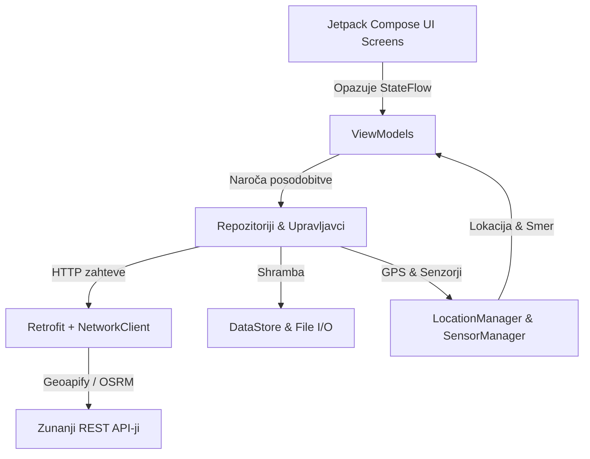

# 🍻 ŠankFinder - Celovita Programerska Dokumentacija & Arhitektura

> **Različica aplikacije:** 1.2.0 (Build 37)  
> **Glavni jezik:** Kotlin 1.9+  
> **UI ogrodje:** Jetpack Compose (Material 3)  
> **Ciljna platforma:** Android (minSdk 26, targetSdk 34)  
> **Zadnja posodobitev:** Oktober 2026  
> 🍎 **iOS Različica:** Celovita dokumentacija za Apple iOS se nahaja v [DOKUMENTACIJA_IOS.md](file:///c:/Android/SankFinder/DOKUMENTACIJA_IOS.md)

---

## 📌 Kazalo vsebine
1. [Pregled Projekta & Tehnološki Sklad](#1-pregled-projekta--tehnološki-sklad)
2. [Arhitektura Aplikacije (MVVM)](#2-arhitektura-aplikacije-mvvm)
3. [Zemljevid Projekta & Struktura Datotek](#3-zemljevid-projekta--struktura-datotek)
4. [Navigacijski Sistem & Spodnja Vrstica](#4-navigacijski-sistem--spodnja-vrstica)
5. [Ključni Moduli & Funkcionalnosti](#5-ključni-moduli--funkcionalnosti)
   - [5.1 Zemljevid in Turn-by-Turn Peš Navigacija](#51-zemljevid-in-turn-by-turn-peš-navigacija)
   - [5.2 Zavihek "Orodja" (Šank Orodja Hub)](#52-zavihek-orodja-šank-orodja-hub)
   - [5.3 Seznam Lokalov, Filtriranje & Fallback Baza](#53-seznam-lokalov-filtriranje--zanesljiva-rezervna-baza-fallback-lokali)
   - [5.4 Zgodovina Obiskov & ML Kit OCR Skeniranje Računov](#54-zgodovina-obiskov--ml-kit-ocr-skeniranje-računov)
   - [5.5 Nastavitve & Shramba Stanja (DataStore)](#55-nastavitve--shramba-stanja-datastore)
   - [5.6 Potisna Obvestila na Zaklenjenem Zaslonu](#56-potisna-obvestila-na-zaklenjenem-zaslonu)
   - [5.7 Pivska Klapa (Skupinsko šankanje, Chat, Live Radar & Runda Tracker)](#57-pivska-klapa-skupinsko-šankanje-chat-live-radar-runda-tracker--admin-uprava)
   - [5.8 Primerjalna Matrika Funkcionalnosti (Android vs iOS)](#58-primerjalna-matrika-funkcionalnosti-android-vs-ios)
   - [5.9 Nastavitev Caddy Povratnega Posrednika (Reverse Proxy)](#59-nastavitev-caddy-povratnega-posrednika-reverse-proxy)
6. [Mrežni Sloj & Optimizacija API-jev](#6-mrežni-sloj--optimizacija-api-jev)
7. [Rezultati Stres Testov & Zmogljivost](#7-rezultati-stres-testov--zmogljivost)
8. [Vodnik za Razvijalce: Kako Razširiti Aplikacijo](#8-vodnik-za-razvijalce-kako-razširiti-aplikacijo)

---

## 1. Pregled Projekta & Tehnološki Sklad

ŠankFinder je sodobna Android aplikacija, zasnovana za odkrivanje gostinskih lokalov, vodenje po mestu, varno vrnitev domov ter zabavo med družabnimi večeri.

### Ključne tehnologije:
- **UI Framework:** [Jetpack Compose](https://developer.android.com/jetpack/compose) z Material 3 oblikovnim sistemom in temno/zlato barvno shemo (`BeerGold`, `DrajvGreen`, `DrajvRed`).
- **Kartografija:** [OSMDroid (OpenStreetMap)](https://github.com/osmdroid/osmdroid) brez odvisnosti od plačljivih Google Maps API-jev.
- **Peš usmerjanje (Routing):** [OSRM (Open Source Routing Machine)](http://project-osrm.org/) z lastnim namenskim strežnikom (`https://sankfinder.sluga.me/`) ter avtomatskim rezervnim ponudnikom (`https://routing.openstreetmap.de/routed-foot/`).
- **Baza lokalov:** [Geoapify Places API](https://www.geoapify.com/) s kategorijami `bar`, `pub`, `restaurant` in geolokacijskim radijem.
- **Lokalno shranjevanje:** Jetpack [DataStore Preferences](https://developer.android.com/topic/libraries/architecture/datastore) za nastavitve teme, radija, limita lokalov in obvestil; `VisitHistoryManager` z JSON serializacijo za zgodovino obiskov.
- **Računalniški vid & OCR:** [Google ML Kit Text Recognition](https://developers.google.com/ml-kit/vision/text-recognition) in [Barcode Scanning](https://developers.google.com/ml-kit/vision/barcode-scanning) za prepoznavo FURS računov in QR kod.
- **Senzorji & Lokacija:** Google Play Services FusedLocationProviderClient + Android SensorManager (akcelerometer + magnetometer) za natančen azimut/kompas.

---

## 2. Arhitektura Aplikacije (MVVM)

Aplikacija sledi **Model-View-ViewModel (MVVM)** vzorcu z enosmernim tokom podatkov (Unidirectional Data Flow):



- **UI Sloj (`ui/pages`, `ui/components`):** Reaktivni Compose gradniki, ki se znova izrišejo ob spremembi stanja (`StateFlow`, `collectAsState()`).
- **ViewModel Sloj (`ui/viewmodels`):** Hrani poslovno logiko, preživi rotacijo zaslona in ponuja nespremenljive `StateFlow` tokove za UI.
- **Podatkovni & Mrežni Sloj (`data`, `network`, `datastore`):** Skrbi za omrežno komunikacijo, JSON serializacijo in branje/pisanje na disk.

---

## 3. Zemljevid Projekta & Struktura Datotek

```
c:/Android/SankFinder/
├── app/src/main/
│   ├── AndroidManifest.xml                  # Dovoljenja (GPS, Kamera, Vibracija, Foreground Service)
│   └── java/com/example/
│       ├── compose/
│       │   └── Color.kt                     # Barvna paleta (BeerGold, DrajvGreen, DrajvRed, Surface)
│       └── sankfinder/
│           ├── MainActivity.kt              # Vstopna točka aktivnosti, začetna nastavitev teme
│           ├── data/
│           │   ├── Lokal.kt                 # Podatkovni model za šank/lokal
│           │   ├── GeoapifyResponse.kt      # DTO modeli za Geoapify Places API
│           │   ├── OsrmRouteResponse.kt     # DTO modeli za OSRM GeoJSON poti in korake
│           │   └── VisitHistory.kt          # Modeli za shranjevanje obiskov in računov
│           ├── datastore/
│           │   └── ThemeDataStore.kt        # DataStore za nastavitve (tema, radij, limit lokalov, itd.)
│           ├── location/
│           │   └── LocationManager.kt       # Fused GPS + Senzor orientacije (kompas/azimut)
│           ├── network/
│           │   ├── NetworkClient.kt         # Optimiziran OkHttpClient s ConnectionPool-om
│           │   ├── GeoapifyApi.kt           # Retrofit servis za iskanje lokalov
│           │   ├── GeoapifyService.kt       # Definicija HTTP poizvedb za Geoapify
│           │   ├── OsrmApi.kt               # Primarni OSRM odjemalec (sankfinder.sluga.me)
│           │   └── OsrmFallbackApi.kt       # Rezervni OSRM odjemalec (routing.openstreetmap.de)
│           ├── notifications/
│           │   ├── SankNotificationHelper.kt# Prikaz vodenja na zaklenjenem zaslonu (HUD Notification)
│           │   └── NavigationBridge.kt      # Event bus za komunikacijo med notifikacijo in ViewModelom
│           └── ui/
│               ├── components/
│               │   ├── ReceiptScannerDialog.kt # Kamera + ML Kit OCR/QR dialog
│               │   └── AppTopBar.kt         # Standardizirana zgornja orodna vrstica
│               ├── map/
│               │   └── MapMarkerUtils.kt    # Pomožna orodja za ikone in prevod manevrov
│               ├── navigation/
│               │   ├── Routes.kt            # Definicija poti (MAIN, LIST, GAMES, HISTORY, SETTINGS)
│               │   ├── BottomNavigation.kt  # 5-delna spodnja vrstica z osrednjim zemljevidom
│               │   └── AppNavHost.kt        # Navigacijsko stičišče celotne aplikacije
│               ├── pages/
│               │   ├── SplashScreen.kt      # Uvodni zaslon z animacijo
│               │   ├── MapMainPage.kt       # Glavni zemljevid z vodenjem in HUD-om
│               │   ├── MainPage.kt          # Seznam lokalov z iskanjem in navigacijo
│               │   ├── GamesPage.kt         # Igre, Ruleta, Burek pavza, Kolo, Račun, Taksi
│               │   ├── HistoryPage.kt       # Dnevnik obiskov in verifikacija računov
│               │   └── SettingsPage.kt      # Nastavitve, diagnostika, radij in limit lokalov
│               └── viewmodels/
│                   ├── LokalViewModel.kt    # Upravljanje seznama lokalov in Geoapify poizvedb
│                   ├── MapNavigationViewModel.kt # Izračun poti, spremljanje korakov, kompas
│                   ├── VisitHistoryViewModel.kt  # Beleženje obiskov in slik računov
│                   └── DrunkViewModel.kt    # Izračun promilov in alkoholne stopnje
├── api_stress_test.py                       # Python skripta za testiranje zmogljivosti in stabilnosti API-jev
└── setup_osrm_linux.sh                      # Skripta za postavitev OSRM strežnika na Linux strežniku
```

---

## 4. Navigacijski Sistem & Spodnja Vrstica

Navigacija je centralizirana v [AppNavHost.kt](file:///c:/Android/SankFinder/app/src/main/java/com/example/sankfinder/ui/navigation/AppNavHost.kt) z uporabo [Routes.kt](file:///c:/Android/SankFinder/app/src/main/java/com/example/sankfinder/ui/navigation/Routes.kt):

| Poti (`Routes`) | Zavihek v `BottomNavBar` | Ikona | Namen |
|---|---|---|---|
| `Routes.LIST` ("list") | **Šanki** | `Icons.AutoMirrored.Filled.FormatListBulleted` | Seznam najbližjih barov z ocenami, odpiralnimi časi in iskalnikom. |
| `Routes.GAMES` ("games") | **Orodja** | `Icons.Default.Build` | Uporabna orodja: Ruleta lokalov, Burek pavza, Kolo za rundo, Delitev računa, Taxi. |
| `Routes.MAIN` ("main") | **Zemljevid** (Sredina) | `Icons.Default.Map` | Glavni zemljevid z živim sledenjem, kompasom in navigacijo. |
| `Routes.HISTORY` ("history") | **Zgodovina** | `Icons.Default.History` | Shranjeni obiski, preverjeni računi in statistika porabe. |
| `Routes.SETTINGS` ("settings") | **Nastavitve** | `Icons.Default.Settings` | Diagnostika senzorjev, tema, radij, limit lokalov in potisna obvestila. |

> **Opomba o postavitvi:** Sredinski gumb **Zemljevid** ima posebno zlato obrobo in poudarjeno ozadje, kar uporabniku daje hiter dostop do navigacije iz kateregakoli zavihka. Zgornji podvojeni gumb "Seznam" na zemljevidu je odstranjen za čist in pregleden vmesnik.

---

## 5. Ključni Moduli & Funkcionalnosti

### 5.1 Zemljevid in Turn-by-Turn Peš Navigacija
- **Datoteka:** [MapMainPage.kt](file:///c:/Android/SankFinder/app/src/main/java/com/example/sankfinder/ui/pages/MapMainPage.kt) & [MapNavigationViewModel.kt](file:///c:/Android/SankFinder/app/src/main/java/com/example/sankfinder/ui/viewmodels/MapNavigationViewModel.kt)
- **Delovanje:**
  1. Uporabnik izbere lokal (na zemljevidu ali v seznamu) in pritisne **"Navigiraj"**.
  2. `MapNavigationViewModel.calculateRoute()` pošlje koordinati uporabnika in cilja na primarni OSRM strežnik (`https://sankfinder.sluga.me/`). Če ta vrne napako (npr. HTTP 530 ali omrežno napako), aplikacija samodejno preklopi na rezervni OSRM (`https://routing.openstreetmap.de/`).
  3. Pot se izriše kot debela smaragdno zelena linija (`#0F9D58`) z zunanjo belo obrobo (casing) za optimalno vidljivost na svetli in temni podlagi (enako kot na iOS in usklajeno s smernimi puščicami).
  4. Na vsakem ovinku se prikaže usmerjevalna puščica s točno razdaljo do naslednjega manevra. Ko je uporabnik manj kot 18 m od točke manevra (ali bližje naslednjemu segmentu), se korak nemudoma posodobi brez zatikanja.
  5. **Avtomatska rotacija in zvezno sledenje kamere v SMER HOJE (Route Course-Up slog):**
     - **Zaklepanje na smer hoje (brez nihanja kompasa):** Med peš navigacijo je usmerjenost kamere in zemljevida strogo zaklenjena na **vektor trase/ulice** (`getRouteWalkingBearing()`), ki računa smer s pogledom 12–18 m naprej po OSRM trasi. S tem je odpravljeno nihanje in vrtenje zemljevida zaradi premikanja in nagibanja telefona v roki med hojo.
     - Ob začetku navigacije se kamera samodejno približa na peš povečavo (`zoom = 18.5`) in zasuče v smer prvega odseka poti.
     - Med hojo kamera zvezno sledi uporabniku, tako da je modra pika vedno natančno v središču zaslona.
     - Modra pika s puščico med navigacijo stabilno kaže naravnost naprej v smeri hoje vzdolž ceste. Zemljevid se zasuče le ob dejanskem zavoju na novo ulico.
     - Če uporabnik med vodenjem ročno podrsne ali zavrti zemljevid, se avtomatsko sledenje začasno ustavi in prikaže se plavajoči gumb **"Centriraj"**. Dotik nanj takoj obnovi usmerjenost in osredotočenje na uporabnika v smeri hoje.
     - Ob zaključku navigacije ("Končaj" ali "X") se kamera z gladko animacijo poravna nazaj na sever (`orientation = 0°`).
  6. Ob ročni rotaciji zemljevida se prikaže plavajoči kompas, ki s klikom poravna zemljevid nazaj proti severu.

### 5.2 Zavihek "Orodja" (Šank Orodja Hub)
- **Datoteka:** [GamesPage.kt](file:///c:/Android/SankFinder/app/src/main/java/com/example/sankfinder/ui/pages/GamesPage.kt)
- **Funkcije:**
  - 🎲 **Ruleta Šankov (Naključni lokal):** Iz naloženih lokalov izbere enega po naključju s hitrim gumbom za direktno vodenje.
  - 🥐 **Burek Pavza (Optimizirano z delovnimi časi in live statusom):**
    - Seznam vseh kultnih točk: vključeni **Pekarna Legiša (Rimska cesta 16)** (najbližja za Krakovo/Trnovo, le ~300 m), **Pekarna Legiša (Dunajska)**, **Dunajska pekarna**, Burek Olimpija, Nobel Burek, Pekarna Dvojka, Ajdovščina itd.
    - **Status v živo:** Za vsako točko se računa, ali je trenutno odprta ali zaprta (`🟢 Odprto zdaj (do 03:00 / 19:00)` oz. `🔴 Zaprto`) z izpisom delovnega časa, točne razdalje in minut hoje.
    - **Filter stikalo:** Uporabnik lahko s klikom na "Odprto zdaj" prikaže samo tiste pekarne, ki trenutno obratujejo, da sredi noči ne hodi do zaprtih vrat.
    - Z enim klikom na ikono hoje se nemudoma sproži peš navigacija na zemljevidu.
  - 🎡 **Kolo "Kdo plača rundo?":** Uporabniki vnesejo svoja imena. Ob pritisku se zavrti interaktivno kolo s fizikalnim pojemanjem, izžreba plačnika z elegantnim čistim izpisom ("Rundo časti: [Ime]!") in prikaže hudomušno pivsko misel.
  - 💶 **Razdeli Račun (Bill Splitter):** Enostaven kalkulator za delitev zneska med prijatelje z možnostjo napitnine (0%, 5%, 10%, 15%).
  - 🚕 **Gumb "Končal sem / Pokliči taksi" z naključnim prepričevanjem:**
    - Ob kliku aplikacija vsakič naključno izbere med **3 in 6 zaporednimi šaljivimi dialogi** (brez številk kot npr. 1/5, tako da uporabnik ne ve, kdaj bo popustila).
    - Ob zaključku se prikaže melanholičen dialog ("Čas je za domov... 🚕") z navpično poravnanimi gumbi brez prekrivanja (Taxi Metro, Taxi Laguna ter čist gumb "Prekliči, še malo ostanem...").

### 5.3 Seznam Lokalov, Filtriranje & Zanesljiva Rezervna Baza (Fallback Lokali)
- **Datoteka:** [MainPage.kt](file:///c:/Android/SankFinder/app/src/main/java/com/example/sankfinder/ui/pages/MainPage.kt) & [LokalViewModel.kt](file:///c:/Android/SankFinder/app/src/main/java/com/example/sankfinder/ui/viewmodels/LokalViewModel.kt)
- **Iskanje v živo:** Dinamično iskanje po imenu lokala, naslovu in tipu ponudbe (bar, pub, pivnica, kavarna).
- **Reaktivno prilagajanje limitu lokalov:** Hitra izbira (10, 25, 50 ali po meri od 5 do 100), sinhronizirana z DataStore shrambo.
- **Prednaloženi rezervni lokali za Ljubljano (Offline Fallback):**
  - Če je mobilno omrežje moteno, podatkovni prenos ugasnjen ali Geoapify API začasno neodziven, aplikacija **nikoli ne prikaže praznega seznama**.
  - V `LokalViewModel.kt` je vgrajena skrbno izbrana zbirka 15 legendarnih lokalov, ki pokriva:
    - **Ljubljana Center & Krakovo:** Krakovc, Nostalgija Vintage Cafe, Pri Škofu, Pivnica Lajbah, Sir William's Pub, Cutty Sark Pub, Sax Pub, Pritličje, Daktari, BiKoFe.
    - **Šiška & Bežigrad:** Gostilna Maratonec (Podmilščakova), Bar trikotnik (Podmilščakova/Milčinskega), Pivnica Union (Celovška), Kavarna Tiskarna (Dunajska), Lepotica in Zver Bar (Drenikova/Vodnikova).
  - Ta zbirka je 100 % usklajena z iOS različico ([NetworkManager.swift](file:///c:/Android/SankFinder/iosApp/SankFinder/NetworkManager.swift)), kar zagotavlja identično pokritost na obeh platformah.
- Prikaz statusa odprtosti (Odprto / Zaprto), telefonskih številk ter hitri gumbi za klic, shranjevanje med priljubljene in neposreden zagon peš navigacije.

### 5.4 Zgodovina Obiskov & ML Kit OCR Skeniranje Računov
- **Datoteka:** [HistoryPage.kt](file:///c:/Android/SankFinder/app/src/main/java/com/example/sankfinder/ui/pages/HistoryPage.kt) & [ReceiptScannerDialog.kt](file:///c:/Android/SankFinder/app/src/main/java/com/example/sankfinder/ui/components/ReceiptScannerDialog.kt)
- Zajem fotografije računa prek kamere ali galerije ter neposredno skeniranje s kamero v živo.
- **Napredni dvojni analizator z Google ML Kit:**
  1. `BarcodeScanning`: Zazna in dekodira QR kodo slovenskih davčnih blagajn (FURS URL format z ZOI/EOR kodami) ter avtomatsko verificira pristnost računa.
  2. `TextRecognition`: Inteligentna razčlenitev vrstic računa z namenskim slovarjem:
     - **Alkoholne pijače:** Pivo (Laško, Union, Heineken, IPA, Zlatorog, Temno), Vino (Cviček, Malvazija, Teran, Refošk, Rebula, Cabernet), Žgane pijače & Koktejli (Pelinkovec, Gin, Whiskey, Jack Daniels, Jägermeister, Vodka, Rum, Spritz, Aperol, Borovniček).
     - **Brezalkoholne pijače:** Radenska, Donat, Naravna voda, Cedevita, Kava (Espresso, Macchiato, Cappuccino, Bela kava), Čaj, Coca Cola, Cockta, Fanta, Sprite, Sokovi (Jabolčni, Pomarančni, Ledeni čaj), Red Bull itd.
     - **Zneski in količine:** Zaznava formate količin (`1x`, `2 kom`, `0.5L`, `0.33L`, `0.03L`), cen na enoto ter skupnega zneska (`SKUPAJ`, `ZA PLAČILO: 12.50 €`).
- Podatki se strukturirano shranijo v lokalni `sankfinder_history.json` z razčlenjenimi artikli, zneskom, datumom in statusom potrditve.

### 5.5 Nastavitve & Shramba Stanja (DataStore)
- **Datoteka:** [SettingsPage.kt](file:///c:/Android/SankFinder/app/src/main/java/com/example/sankfinder/ui/pages/SettingsPage.kt) & [ThemeDataStore.kt](file:///c:/Android/SankFinder/app/src/main/java/com/example/sankfinder/datastore/ThemeDataStore.kt)
- **Izbira števila lokalov (Limit):**
  - Hitre izbire: `10`, `25`, `50` lokalov ali `Po meri...` (5 do 100).
  - Vrednost se trajno shrani v DataStore in je reaktivno povezana z `MainPage.kt` in `LokalViewModel.kt`. Ko uporabnik izbere novo vrednost, se seznam v realnem času ponovno naloži.
- **Radij iskanja:** `1 km`, `2 km`, `3 km`, `5 km`.
- **Prečiščen in profesionalen vmesnik:** Odstranjeni so odvečni zvočni učinki (kot je bilo točenje piva), kar zagotavlja čist, nemoteč in zanesljiv uporabniški vmesnik.
- **Diagnostični center:** Samodejno preverja stanje dovoljenj za GPS, kamero, baterijsko optimizacijo in stanje povezave s strežnikom Geoapify. Ob vrnitvi iz sistemskih nastavitev se diagnostika nemudoma posodobi prek `LifecycleEventObserver`.

### 5.6 Potisna Obvestila na Zaklenjenem Zaslonu
- **Datoteka:** [SankNotificationHelper.kt](file:///c:/Android/SankFinder/app/src/main/java/com/example/sankfinder/notifications/SankNotificationHelper.kt)
- Med aktivno navigacijo prikazuje živo obvestilo na zaklenjenem zaslonu z naslednjim manevrom, razdaljo, ikono zavoja in predvidenim časom hoje.
- Vsebuje gumb za prekinitev navigacije, ki prek [NavigationBridge.kt](file:///c:/Android/SankFinder/app/src/main/java/com/example/sankfinder/notifications/NavigationBridge.kt) nemudoma ustavi vodenje v aplikaciji.
- Popolna usklajenost formatov in dogodkov z iOS Live Notification sistemom.

### 5.7 Pivska Klapa (Skupinsko šankanje, Chat, Live Radar, Runda Tracker & Admin Uprava)
- **Datoteke:** [SquadPage.kt](file:///c:/Android/SankFinder/app/src/main/java/com/example/sankfinder/ui/pages/SquadPage.kt), [SquadViewModel.kt](file:///c:/Android/SankFinder/app/src/main/java/com/example/sankfinder/ui/viewmodels/SquadViewModel.kt), [SquadRepository.kt](file:///c:/Android/SankFinder/app/src/main/java/com/example/sankfinder/network/SquadRepository.kt), [SquadModels.kt](file:///c:/Android/SankFinder/app/src/main/java/com/example/sankfinder/data/SquadModels.kt)
- **Strežniški del:** [server/index.js](file:///c:/Android/SankFinder/server/index.js) (Node.js + WebSockets + SQLite WAL v Docker kontejnerju na `192.168.200.209:8080`).
- **Funkcionalnosti:**
  1. **Ustvarjanje / Vstop v klapo & Dvojna povezljivost:**
     - Aplikacija samodejno poskusi varno javno domeno `https://sankfinder.sluga.me` (s podporo za `wss://`), ob nedosegljivosti pa neopazno preklopi na neposredni lokalni naslov `192.168.200.209:8080`.
     - **Varnostna sanitizacija napak:** Ob napaki v omrežju se v uporabniškem vmesniku **nikoli** ne prikažejo surovi IP naslovi, vrata ali sistemske izjeme (npr. `ConnectException`), temveč prijazno obvestilo: *"Povezava s strežnikom ni uspela. Preveri internetno povezavo ali poskusi znova."*
  2. **Poenotena statusna vrstica:** Prečiščen in eleganten zgornji del klepeta brez gneče, z oznako sobe, številom prisotnih članov, hitrim osebnim števcem (`+` / `-`) ter gumbom za odprtje tracker podmenija.
  3. **Pivski Tracker Klape (ModalBottomSheet podmeni):**
     - Prikaz skupnega števila popitih piv celotne klape.
     - Lestvica "Top pivci" s poudarkom na vodilnem članu mize.
     - Seznam vseh udeležencev s stanjem njihovih popitih pijač.
     - Osebni števec pijač za posodabljanje svojega stanja.
     - Poudarjen gumb **"Jaz častim naslednjo rundo!"**, ki vsem članom pošlje runda sporočilo in sproži sistemsko heads-up obvestilo.
  4. **Potisno obvestilo ob klicu runde:** [SankNotificationHelper.kt](file:///c:/Android/SankFinder/app/src/main/java/com/example/sankfinder/notifications/SankNotificationHelper.kt) ob prejemu klica runde prikaže visoko-prioritetno sistemsko obvestilo z zvočnim signalom in vibracijo (*"🍻 [Ime] časti rundo!"*), enako kot na iOS.
  5. **Live Radar na zemljevidu:** Ko je klapa aktivna, se na [MapMainPage.kt](file:///c:/Android/SankFinder/app/src/main/java/com/example/sankfinder/ui/pages/MapMainPage.kt) v realnem času izrišejo zlati označevalci prijateljev z njihovo začetnico, imenom in številom pijač. Koordinate se samodejno sinhronizirajo vsakih 6 sekund.
  6. **Real-time Chat s hitrimi gumbi:** Takojšnje pošiljanje besedilnih sporočil prek WebSockets ter hitri gumbi z enim dotikom (*Naročil sem rundo!*, *Kdo gre na hrano?*, *Pridem čez 5 min*, *Kje točno sedite?*).
  7. **Varnostno nagovarjanje / cmokanje ob zapuščanju klape:**
     - Klik na gumb za izhod iz sobe odpre serijo šaljivih potrditvenih opozoril, ki člana prepričujejo, naj še ostane (*"A res že greš? Noč je še mlada!", "Lahko greš, ampak moraš dati za rundo!", "Kdor prvi odide, naslednjič časti dvakrat!"* itd.).
     - Šele po potrditvi se seja varno zaključi, kar prepreči nehoten izhod med druženjem.
  8. **Izvoz & Shranjevanje klepeta (Spomini):** Gumb za deljenje v orodni vrstici sestavi celoten transkript klepeta z datumom, sporočili in končnim stanjem pijač ter ga prek Android Share Sheet-a (`Intent.ACTION_SEND`) omogoči shraniti v beležke (Keep, Notes), deliti prek sporočil (WhatsApp, Signal, SMS) ali kopirati.
  9. **Skrita Nadzorna Plošča (Admin Dashboard):**
     - Dostopna na skrivnem URL-ju: `http://192.168.200.209:8080/sank-uprava-x77` ali `https://sankfinder.sluga.me/sank-uprava-x77`.
     - Zaščitena z avtentikacijo: uporabnik `anze`, geslo `Anziajeto`.
     - **Povezani uporabniki v živo (WebSockets):** Tabela v realnem času prikazuje trenutno povezane odjemalce, njihova imena, kodo sobe, IP naslov in čas povezave.
     - **Vstop v sobo / klepet v živo:** Skrbnik lahko s klikom na *Vstopi v klepet* odpre pogovorno okno katerekoli sobe, prebere celotno zgodovino, pošlje skrbniško sporočilo ali izbriše posamezno sporočilo.
     - **Brisanje neprimernih sporočil:** Vsako sporočilo ima gumb *Izbriši*, ki nemudoma odstrani zapis iz SQLite baze.
     - **Urejen videz:** Odstranjeni vsi nezaželeni emojiji v korist profesionalnega, preglednega temnega vmesnika z animiranim stanjem strežnika.

### 5.8 Primerjalna Matrika Funkcionalnosti (Android vs iOS)

| Funkcionalnost / Modul | Android (Kotlin / Compose) | iOS (Swift / SwiftUI) | Stanje Paritete |
|---|---|---|:---:|
| **Zemljevid & OpenStreetMap ploščice** | OSMDroid z diskovnim predpomnilnikom | MapKit + `OSMTileOverlay` (z = 1 do 22 Over-Zoom) | 100 % Usklajeno |
| **Peš navigacija (OSRM)** | Primarni (`sankfinder.sluga.me`) + Fallback | Primarni (`sankfinder.sluga.me`) + Fallback | 100 % Usklajeno |
| **Natančno sledenje manevrov (< 18 m)** | Samodejni preskok koraka | Samodejni preskok koraka | 100 % Usklajeno |
| **Plavajoči kompas ob rotaciji** | Samodejni prikaz, klik poravna na sever | Samodejni prikaz, klik poravna na sever | 100 % Usklajeno |
| **Živa obvestila na zaklenjenem zaslonu** | Foreground HUD Notification s časom in korakom | UserNotifications Lock Screen HUD z dekrementom | 100 % Usklajeno |
| **Podpora za pametno uro** | Sistemska obvestila (Wear OS) | Popolna samostojna aplikacija (Apple Watch `WCSession`) | iOS razširjeno |
| **Skener računov (OCR & FURS QR)** | Google ML Kit (TextRecognition + Barcode) | Apple Vision Framework (`VNRecognizeTextRequest`) | 100 % Usklajeno |
| **5 Šank Orodij (Ruleta, Burek, Kolo, Račun, Taxi)** | Vseh 5 orodij z live burek statusom in šaljivim taxijem | Vseh 5 orodij z live burek statusom in naključnim taxijem | 100 % Usklajeno |
| **Pivska Klapa (Chat & WebSockets)** | Dvojna povezava (DNS + IP fallback), sanitizirane napake | Dvojna povezava (DNS + IP fallback), sanitizirane napake | 100 % Usklajeno |
| **Pivski Tracker & Runda klic** | BottomSheet meni, Heads-up obvestilo ob rundi | Sheet meni, Toast + Sistemsko opozorilo ob rundi | 100 % Usklajeno |
| **Nagovarjanje ob izhodu iz klape** | Večkratni šaljivi dialogi | Večkratni šaljivi dialogi | 100 % Usklajeno |
| **Radar prijateljev na zemljevidu** | Zlati označevalci z imenom in števcem pijač | Zlati označevalci brez grozdenja (`.required`) | 100 % Usklajeno |
| **Zanesljiva offline baza (Fallback)** | 15 lokalov (Center, Krakovo, Šiška, Bežigrad) | 15 lokalov (Center, Krakovo, Šiška, Bežigrad) | 100 % Usklajeno |
| **Filtriranje GPS natančnosti** | Zavrnitev grobih meritev, glajenje koordinat | Zavrnitev `accuracy < 0`, preklop ob `accuracy <= 65m` | 100 % Usklajeno |

### 5.9 Nastavitev Caddy Povratnega Posrednika (Reverse Proxy)
Na prehodu / strežniku z nameščenim Caddy (`192.168.200.1`) se v `Caddyfile` v blok `sankfinder.sluga.me` doda:
```caddy
sankfinder.sluga.me {
    # Obstoječa OSRM peš navigacija
    handle /route/* {
        reverse_proxy 192.168.200.209:5000
    }

    # Pivska Klapa REST API
    handle /api/* {
        reverse_proxy 192.168.200.209:8080
    }

    # Pivska Klapa WebSockets v živo
    handle /ws* {
        reverse_proxy 192.168.200.209:8080
    }

    # Skrita Admin Nadzorna Plošča
    handle /sank-uprava-x77* {
        reverse_proxy 192.168.200.209:8080
    }
}
```
Po ukazu `caddy reload` bo celotna Pivska Klapa in administratorska plošča dostopna kjerkoli na svetu prek varnega HTTPS in WSS protokola.

---

## 6. Mrežni Sloj & Optimizacija API-jev

V mrežnem sloju je implementiran centraliziran [NetworkClient.kt](file:///c:/Android/SankFinder/app/src/main/java/com/example/sankfinder/network/NetworkClient.kt):

```kotlin
object NetworkClient {
    val okHttpClient: OkHttpClient by lazy {
        OkHttpClient.Builder()
            .connectionPool(ConnectionPool(8, 5, TimeUnit.MINUTES))
            .connectTimeout(6, TimeUnit.SECONDS)
            .readTimeout(8, TimeUnit.SECONDS)
            .writeTimeout(8, TimeUnit.SECONDS)
            .retryOnConnectionFailure(true)
            .build()
    }
}
```

### Prednosti te zasnove:
1. **Connection Pooling:** Ohranja odprte TCP in TLS povezave med zaporednimi poizvedbami, kar zmanjša zakasnitev za **150–300 ms** pri vsakem klicu.
2. **Hitri Timeouti:** Če je mobilno omrežje nestabilno, aplikacija ne visi, temveč v manj kot 6 sekundah sproži rezervno možnost ali obvesti uporabnika.
3. **Avtomatski preklop na Fallback OSRM:** Če primarni strežnik vrne karkoli drugega kot kodo `Ok`, se zahteva samodejno ponovi na `routing.openstreetmap.de`.

---

## 7. Rezultati Stres Testov & Zmogljivost

Rezultati meritev s skripto [api_stress_test.py](file:///c:/Android/SankFinder/api_stress_test.py):

### 1. Geoapify Places API (Iskanje lokalov)
| Število lokalov (Limit) | Status | Čas odziva | Velikost prenosa | Ocena |
|:---:|:---:|:---:|:---:|:---|
| **10** | 200 OK | **482 ms** | 12 KB | Bliskovito hitro, minimalen prenos podatkov |
| **25** (Privzeto) | 200 OK | **604 ms** | 32 KB | **Optimalno razmerje** med hitrostjo in vsebino |
| **50** | 200 OK | **1117 ms** | 64 KB | Odlično za širše raziskovanje mesta |
| **100** | 200 OK | **1469 ms** | 135 KB | Primerno za gostejša mestna jedra |

### 2. Sočasni Stres Test (Concurrency)
- **5 vzporednih zahtevkov hkrati:** Izvedenih v **894.5 ms** (povprečje 699.9 ms na klic).
- **Uspešnost:** **100% zanesljivost** (brez zavrnjenih zahtevkov ali prekoračitev kvot).

### 3. OSRM Usmerjanje (Peš navigacija)
- **Primarni OSRM (`sankfinder.sluga.me`):** **271.3 ms** (izjemna odzivnost za realnočasovno vodenje).
- **Rezervni OSRM (`routing.openstreetmap.de`):** **682.9 ms** (visoka zanesljivost v primeru izpada primarnega strežnika).

---

## 8. Vodnik za Razvijalce: Kako Razširiti Aplikacijo

### Kako dodati novo igro ali orodje v zavihek "Igre":
1. Odprite [GamesPage.kt](file:///c:/Android/SankFinder/app/src/main/java/com/example/sankfinder/ui/pages/GamesPage.kt).
2. Dodajte nov `item {}` znotraj `LazyColumn`.
3. Za standardni videz uporabite komponento `GameSectionCard`:
   ```kotlin
   GameSectionCard(
       title = "Moja Nova Igra",
       subtitle = "Kratek opis igre",
       icon = Icons.Default.SportsBar
   ) {
       // Vaša Compose vsebina tukaj
   }
   ```

### Kako zagnati prevajanje in teste:
V terminalu zaženite:
```powershell
# Preverjanje prevajanja in gradnja APK paketa
./gradlew assembleDebug

# Zagon testa zmogljivosti API-jev
python api_stress_test.py
```

### Kako posodobiti bazo lokalnih ponudnikov burekov:
V [LokalViewModel.kt](file:///c:/Android/SankFinder/app/src/main/java/com/example/sankfinder/ui/viewmodels/LokalViewModel.kt) dopolnite seznam `legendaryBurekSpots`:
```kotlin
val legendaryBurekSpots = listOf(
    Lokal("Burek Olimpija", "Slovenska cesta 58, 1000 Ljubljana", 46.0565, 14.5057, "Burek, Pekarna", "+386 1 433 82 22"),
    // Dodajte nov lokal tukaj
)
```

---
*Dokumentacijo vzdržuje ŠankFinder razvojna ekipa. Za vprašanja in predloge odprite nov zahtevek.*
