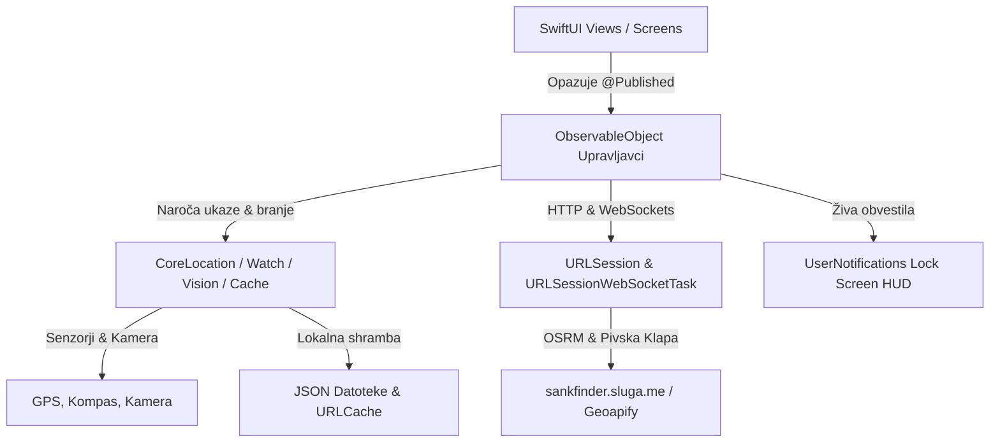

# 🍎 ŠankFinder iOS - Celovita Programerska Dokumentacija & Arhitektura

> **Različica aplikacije:** 1.2.0 (Build 36)  
> **Glavni jezik:** Swift 5.9+  
> **UI ogrodje:** SwiftUI + UIKit (MapKit integracija prek `UIViewRepresentable`)  
> **Ciljna platforma:** iOS 16.0+, watchOS 9.0+  
> **Zadnja posodobitev:** Oktober 2026

---

## 📌 Kazalo vsebine
1. [Pregled Projekta & Tehnološki Sklad iOS](#1-pregled-projekta--tehnološki-sklad-ios)
2. [Arhitektura Aplikacije (MVVM + Combine)](#2-arhitektura-aplikacije-mvvm--combine)
3. [Zemljevid Projekta & Struktura Datotek](#3-zemljevid-projekta--struktura-datotek)
4. [Navigacijski Sistem & Spodnja Vrstica (5 zavihkov)](#4-navigacijski-sistem--spodnja-vrstica-5-zavihkov)
5. [Ključni Moduli & Tehnične Rešitve](#5-ključni-moduli--tehnične-rešitve)
   - [5.1 Zemljevid & OpenStreetMap Over-Zoom Podpora (CustomMapView.swift)](#51-zemljevid--openstreetmap-over-zoom-podpora-custommapviewswift)
   - [5.2 Lokacija & Kompas v Ozadju (LocationManager.swift)](#52-lokacija--kompas-v-ozadju-locationmanagerswift)
   - [5.3 Živa Obvestila na Zaklenjenem Zaslonu (LiveNavigationManager.swift)](#53-živa-obvestila-na-zaklenjenem-zaslonu-livenavigationmanagerswift)
   - [5.4 Podpora za Apple Watch (WatchConnectivityManager.swift)](#54-podpora-za-apple-watch-watchconnectivitymanagerswift)
   - [5.5 Prepoznavanje Računov z Apple Vision OCR & QR (HistoryManager.swift)](#55-prepoznavanje-računov-z-apple-vision-ocr--qr-historymanagerswift)
   - [5.6 Orodja & Igre (ToolsView.swift)](#56-orodja--igre-toolsviewswift)
   - [5.7 Pivska Klapa (SquadManager.swift & SquadView.swift)](#57-pivska-klapa-squadmanagerswift--squadviewswift)
   - [5.8 Nastavitve & Globalno Uravnavanje Tipkovnice](#58-nastavitve--globalno-uravnavanje-tipkovnice)
6. [Postopek Gradnje & Generiranje IPA Paketa (CI/CD)](#6-postopek-gradnje--generiranje-ipa-paketa-cicd)
7. [Navodila za Razvijalce & Sinhronizacija z Androidom](#7-navodila-za-razvijalce--sinhronizacija-z-androidom)

---

## 1. Pregled Projekta & Tehnološki Sklad iOS

ŠankFinder za iOS je izvorna (native) mobilna aplikacija, razvita posebej za operacijski sistem iOS z najsodobnejšim SwiftUI skladom. Uporablja identično vizualno podobo, barvno shemo in podatkovno zaledje kot Android različica, s čimer ponuja 100 % usklajeno uporabniško izkušnjo ne glede na uporabljeno napravo.

### Ključne tehnologije:
- **UI Ogrodje:** SwiftUI z deklarativnim stanjem in UIKit premostitvijo (`UIViewRepresentable`) za napreden nadzor nad `MKMapView`.
- **Oblikovni sistem:** Temna pivska tema s prilagojenimi barvnimi toni:
  - `BeerGold` (`#F59E0B` / `Color.yellow.opacity(0.9)`)
  - `DrajvGreen` (`#10B981` / svetlo zelena za aktivne označevalce in gumbe)
  - `DarkGreen` (`#047857` / poudarjeno stanje izbranega lokala)
  - `DrajvRed` (`#EF4444` / opozorila in prekinitev)
  - `SurfaceDark` (`#121826` / globoka nočna podlaga s prosojnim steklenim efektom)
- **Kartografija:** [MapKit](https://developer.apple.com/documentation/mapkit) z lastnim `OSMTileOverlay` podsistemom:
  - Uporaba OpenStreetMap Mapnik ploščic (`https://tile.openstreetmap.org/`).
  - `canReplaceMapContent = true` za popoln izklop Apple Maps vektorske podlage.
  - Dinamični Over-Zoom (do nivoja `z = 22`) z digitalnim izrezovanjem in povečevanjem ploščic iz izvornega `z = 19`.
- **Peš usmerjanje (Routing):** OSRM strežnik (`https://sankfinder.sluga.me/`) z avtomatskim rezervnim ponudnikom (`https://routing.openstreetmap.de/routed-foot/`).
- **Lokacija & Senzorji:** [CoreLocation](https://developer.apple.com/documentation/corelocation) s podporo za delovanje v ozadju (`allowsBackgroundLocationUpdates`), natančen kompas (`CLHeading`) in samodejni filter razdalje.
- **Obvestila v živo:** [UserNotifications](https://developer.apple.com/documentation/usernotifications) s formatiranim HUD prikazom na zaklenjenem zaslonu.
- **Apple Watch integracija:** [WatchConnectivity](https://developer.apple.com/documentation/watchconnectivity) (`WCSession`) za dvosmerno sinhronizacijo poti in števca pijač.
- **Strojni vid & OCR:** [Apple Vision Framework](https://developer.apple.com/documentation/vision) (`VNRecognizeTextRequest`) ter `AVFoundation` za hitro prepoznavo besedila računov in QR kod brez odvisnosti od oblačnih storitev.
- **Omrežje & WebSockets:** `URLSession` z diskovnim `URLCache` (256 MB) ter `URLSessionWebSocketTask` za realnočasovno klepetanje in radarsko sledenje članom Pivske Klape.

---

## 2. Arhitektura Aplikacije (MVVM + Combine)

Arhitektura aplikacije sledi vzorcu **Model-View-ViewModel (MVVM)** z reaktivnimi tokovi podatkov prek ogrodja **Combine**:



- **Pogledi (`Views`):** Čisti SwiftUI pogledi, ki poslušajo stanje prek `@StateObject` ali `@ObservedObject`.
- **Upravljavci & Modeli stanja (`Managers`):**
  - `LocationManager`: Upravlja GPS, azimut, pravice lokacije in osredotočenje kamere.
  - `LiveNavigationManager`: Skrbi za posodabljanje obvestil na zaklenjenem zaslonu med navigacijo.
  - `WatchConnectivityManager`: Prenaša podatke na Apple Watch uro.
  - `SquadManager`: Skrbi za WebSocket povezavo, klepet in radarsko pozicijo prijateljev.
  - `HistoryManager`: Skrbi za lokalni dnevnik obiskov in OCR analizo računov.

---

## 3. Zemljevid Projekta & Struktura Datotek

```
c:/Android/SankFinder/iosApp/
├── SankFinder/
│   ├── SankFinderApp.swift              # Glavna vstopna točka (@main), zagon lokacije in obvestil
│   ├── ContentView.swift                # 5-delni TabView, plavajoča značka za Klapo, globalna tema
│   ├── CustomMapView.swift              # MKMapView integracija, OSMTileOverlay z Over-Zoom, usmerjevalne puščice
│   ├── MapTabView.swift                 # Glavni zaslon zemljevida, kartica izbranega lokala, navigacijski HUD
│   ├── ListTabView.swift                # Seznam lokalov z iskanjem, filtri in hitro navigacijo
│   ├── ToolsView.swift                  # Kolo sreče, Burek pavza, Delilnik računa, Taksi klic
│   ├── HistoryView.swift                # Zgodovina obiskov, pregled računov in porabe
│   ├── SettingsTabView.swift            # Nastavitve radija, števila lokalov in diagnostika sistema
│   ├── SquadView.swift                  # Vstop v Pivsko Klapo, koda sobe, klepet in runda števec
│   ├── LocationManager.swift            # CoreLocation ovijalec (GPS, azimut, background mode)
│   ├── LiveNavigationManager.swift      # Upravljavec zaklenjenega zaslona (Lock Screen HUD)
│   ├── WatchConnectivityManager.swift   # WCSession most med iPhone in Apple Watch
│   ├── HistoryManager.swift             # JSON shramba obiskov in Apple Vision OCR procesor
│   ├── ReceiptScannerView.swift         # SwiftUI vmesnik za zajem računa s kamero/galerijo
│   ├── Models.swift                     # Lokal, Step, Route, SquadMember in drugi podatkovni modeli
│   ├── Info.plist                       # Sistemska dovoljenja (GPS, Always/InUse, Kamera, Background Modes)
│   └── Assets.xcassets/
│       ├── AppIcon.appiconset/          # Minimalistična moderna ikona aplikacije (1024x1024)
│       └── AccentColor.colorset/        # Zlata sistemska poudarjena barva
├── SankFinderWatch/                     # Aplikacija za Apple Watch (watchOS)
│   ├── SankFinderWatchApp.swift         # Vstopna točka za uro
│   ├── WatchContentView.swift          # Zapestni prikaz navigacijskih puščic, razdalje in pijač
│   └── WatchSessionManager.swift        # Sprejemnik podatkov iz iPhone telefona
├── build_ipa.sh                         # Skripta za sestavo nepodpisanega .ipa paketa
└── download_ipa.ps1                     # PowerShell skripta za prenos zgrajenega paketa iz GitHub Actions
```

---

## 4. Navigacijski Sistem & Spodnja Vrstica (5 zavihkov)

Glavno navigacijsko strukturo določa [ContentView.swift](file:///c:/Android/SankFinder/iosApp/SankFinder/ContentView.swift) s spodnjo orodno vrstico `TabView`:

| Zavihek | Ikona (SF Symbols) | Naslov | Opis delovanja |
|---|---|---|---|
| 0 | `list.bullet` | **Šanki** | Seznam bližnjih lokalov, razvrščenih po razdalji z oceno, delovnim časom in iskalnikom. |
| 1 | `wrench.and.screwdriver` | **Orodja** | Uporabniška orodja: Kolo za rundo, Burek pavza, Razdeli račun, Taksi pomočnik. |
| 2 | `map` (Poudarjena sredina) | **Zemljevid** | Glavni zemljevid z OpenStreetMap ploščicami, GPS sledenjem in vodenjem. |
| 3 | `clock.arrow.circlepath` | **Zgodovina** | Pregled preteklih obiskov, statistika porabe ter skener računov. |
| 4 | `gearshape` | **Nastavitve** | Izbira radija, limita lokalov, diagnostika senzorjev in sistemske informacije. |

### Plavajoči gumb Pivske Klape:
Na zaslonu z zemljevidom se levo zgoraj nahaja plavajoča značka Pivske Klape. Če je uporabnik včlanjen v klapo, značka prikazuje število prijateljev v živo in skupno število popitih piv. S klikom nanjo se takoj odpre okno klepeta in runda števca brez zapuščanja zemljevida.

---

## 5. Ključni Moduli & Tehnične Rešitve

### 5.1 Zemljevid & OpenStreetMap Over-Zoom Podpora (CustomMapView.swift)

Ker Apple MapKit privzeto izrisuje lastno podlago, je bilo potrebno izdelati napreden `MKTileOverlay` mehanizem, ki v celoti nadomesti Apple Maps:

```swift
class OSMTileOverlay: MKTileOverlay {
    private let maxNativeZ: Int = 19
    
    init() {
        super.init(urlTemplate: "https://tile.openstreetmap.org/{z}/{x}/{y}.png")
        self.canReplaceMapContent = true // 1. Popoln izklop Apple Maps
        self.maximumZ = 22               // 2. Dovoljen zum do z = 22
        self.tileSize = CGSize(width: 256, height: 256)
    }
}
```

#### Rešeni izzivi:
1. **Odprava utripanja med zumiranjem:**  
   Z nastavitvijo `self.canReplaceMapContent = true` MapKit popolnoma ustavi izrisovanje Apple Maps vektorske podlage v ozadju. Med nalaganjem novih ploščic ni več prosevanja Apple barv ali stavb.
2. **Digitalni Over-Zoom (Povečava nad z = 19):**  
   Uradni OpenStreetMap strežnik ponuja izvorne ploščice le do nivoja `z = 19`. Ko se uporabnik na iOS približa na manj kot 100 metrov (npr. `minCenterCoordinateDistance: 85.0`), bi MapKit brez posebne obdelave ugasnil sloj in prikazal prazno podlago.  
   Naš algoritem v `loadTile(at:result:)`:
   - Preveri, ali je `path.z > 19`.
   - Izračuna zamik `diff = path.z - 19` in določi nadrejeno ploščico pri `z = 19`:
     ```swift
     let parentX = path.x >> diff
     let parentY = path.y >> diff
     ```
   - Naloži izvorno ploščico iz `z = 19`, izreže točen kvadrant glede na ostanek `childX % (1 << diff)` in `childY % (1 << diff)` ter ga z `UIGraphicsImageRenderer` poveča nazaj na polno ločljivost `256x256` točk.
   - Rezultat shrani v pomnilniški predpomnilnik (`tileCache`).
3. **Diskovni predpomnilnik (URLCache):**  
   Konfiguriran je namenski `URLSession` z diskovno kapaciteto **256 MB** in pomnilniško kapaciteto **64 MB**. Vsak zahtevek preveri kodo `HTTP 200` in veljavnost slikovnih podatkov (`UIImage(data:) != nil`).
4. **Razporeditev slojev (Overlay Levels):**  
   - `OSMTileOverlay` se doda na nivo `mapView.addOverlay(osmOverlay, level: .aboveRoads)`.
   - Navigacijska trasa `MKPolyline` se doda na nivo `uiView.addOverlay(polyline, level: .aboveLabels)`.  
   S tem je 100 % zagotovljeno, da je zelena navigacijska črta vedno na vrhu nad vsemi ploščicami.
5. **Ukrivljena puščica naslednjega manevra na cestišču:**  
   Poseben razred `CurvedManeuverAnnotation` na točki naslednjega ovinka izriše dinamično ukrivljeno puščico, ki se samodejno poravna s smerjo cestišča in rotacijo zemljevida.
6. **Čisto upravljanje izbire označevalcev:**  
   Ko uporabnik klikne na lokal, se označevalec obarva temno zeleno in rahlo poveča (1.25x). Ob zaprtju podrobnosti ali izbiri drugega lokala se prejšnji označevalec takoj in zanesljivo povrne v privzeto stanje.

---

### 5.2 Lokacija & Kompas v Ozadju (LocationManager.swift)

- Skrbi za posodobitve GPS koordinat prek `CLLocationManager`.
- Omogoča natančnost `kCLLocationAccuracyBest` in dinamični filter razdalje (5 metrov).
- Vključuje podporo za ozadje: `allowsBackgroundLocationUpdates = true` in `pausesLocationUpdatesAutomatically = false`.
- Zaznava smer kompasa (`startUpdatingHeading()`), kar omogoča vrtenje usmerjevalnega stožca modre pike uporabnika (`UserHeadingAnnotationView`).

---

### 5.3 Živa Obvestila na Zaklenjenem Zaslonu (LiveNavigationManager.swift)

Med aktivno peš navigacijo se v sistemskem centru za obvestila prikazuje dinamično obvestilo, oblikovano po zgledu sodobnih navigacijskih aplikacij (Google Maps / Apple Maps):

```
┌────────────────────────────────────────────────────────┐
│  ↰ 250 m • Zavijte levo na Slovensko cesto             │
│  Peš • 4 min (320 m) • Prihod ob 21:15                 │
│  ●━━━━━━━━━━━━━━━━━━━━○                                │
└────────────────────────────────────────────────────────┘
```

- **Posodabljanje v realnem času:** Ob vsakem premiku se osvežijo razdalja do ovinka, predviden čas hoje in ime naslednje ulice.
- **Prekinitev z enim dotikom:** Obvestilo vsebuje neposredno dejanje za zaustavitev navigacije brez odpiranja celotne aplikacije.

---

### 5.4 Podpora za Apple Watch (WatchConnectivityManager.swift)

- Implementira `WCSessionDelegate` za komunikacijo med iPhone-om in povezano uro Apple Watch.
- **Zapestna navigacija:** Prenaša trenutno usmerjevalno puščico (npr. zavoj levo, naravnost, cilj), razdaljo v metrih in čas do naslednjega lokala.
- **Zapestni pivski števec:** Prikazuje trenutno število popitih pijač v Pivski Klapi in omogoča hitro dodajanje piva z zapestja (`+1`).

---

### 5.5 Prepoznavanje Računov z Apple Vision OCR & QR (HistoryManager.swift)

Aplikacija vsebuje lokalni sistem računalniškega vida, ki ne potrebuje zunanjih plačljivih storitev:

1. **Prepoznava besedila (Apple Vision):**
   - Uporablja `VNRecognizeTextRequest` z nastavitvijo `recognitionLevel = .accurate` in jezikovno podporo za slovenščino.
2. **Katalog pijač & razčlenjevanje artiklov:**
   - Prepoznava vrstice z alkoholnimi pijačami: *Pivo, Laško, Union, Heineken, Cviček, Malvazija, Gin, Pelinkovec, Jack Daniels, Jägermeister, Vodka, Spritz, Aperol*.
   - Prepoznava brezalkoholne pijače: *Radenska, Donat, Naravna voda, Cedevita, Kava, Espresso, Cappuccino, Čaj, Coca Cola, Cockta, Fanta, Sprite, Ledeni čaj, Red Bull*.
   - Inteligentno izlušči količine (`1x`, `2x`, `0.5L`, `0.33L`) in zneske.
3. **Verifikacija FURS QR kode:**
   - Zazna QR kodo davčne blagajne, prebere zaščitno kodo izdajatelja računa (ZOI/EOR) in avtomatsko označi račun kot preverjen.

---

### 5.6 Orodja & Igre (ToolsView.swift)

- 🎡 **Kolo sreče ("Kdo plača rundo?"):**
  - Interaktivno vrteče se kolo s fizikalnim pojemanjem.
  - Smerna puščica je natančno nameščena na zgornjem robu kolesa brez zamikov.
  - Haptični odziv (`UIImpactFeedbackGenerator`) ob vsakem preskoku segmenta.
- 🥐 **Burek Pavza z delovnim časom v živo:**
  - Prikaz vseh priljubljenih pekarn (Pekarna Legiša Rimska, Dunajska, Burek Olimpija, Nobel itd.).
  - Samodejni izračun odprtosti (`🟢 Odprto zdaj` / `🔴 Zaprto`) glede na trenutno uro.
  - Gumb za takojšen zagon peš navigacije.
- 💶 **Razdeli račun (Bill Splitter):** Enostaven vnos zneska, števila oseb in izbira napitnine.
- 🚕 **Taksi klic z naključnimi dialogi:** Zaporedje šaljivih prepričevalnih oken z direktno povezavo do klicnih številk lokalnih taksi služb (Taxi Metro, Taxi Laguna).

---

### 5.7 Pivska Klapa (SquadManager.swift & SquadView.swift)

- Skupinsko usklajevanje prek WebSocket protokola (`wss://sankfinder.sluga.me/ws` z varnim preklopom na lokalni naslov).
- **Zlati označevalci prijateljev:** Na zemljevidu se v živo prikazujejo pozicije članov klape z njihovo začetnico in številom pijač.
- **Runda števec:** Skupni seštevek pijač celotne mize z možnostjo dodajanja ali odštevanja.
- **Klepet v živo:** Izmenjava hitrih sporočil med člani klape.

---

### 5.8 Nastavitve & Globalno Uravnavanje Tipkovnice

Za vrhunsko uporabniško izkušnjo so vsi vnosni obrazci opremljeni z:
- Orodno vrstico z gumbom **"Končano"** (`.doneButtonKeyboardToolbar()`) za enostaven umik številčne in besedilne tipkovnice.
- Interaktivnim umikom ob drsenju vsebine (`.scrollDismissesKeyboard(.interactively)`).
- Globalnim prepoznavalnikom dotika za zapiranje tipkovnice ob kliku na prazno površino.

---

## 6. Postopek Gradnje & Generiranje IPA Paketa (CI/CD)

Projekt uporablja avtomatiziran GitHub Actions cevovod na macOS tekaču (`macos-latest`):

1. **GitHub Delotok:** `.github/workflows/ios-build.yml`
   - Preveri Swift sintakso in odvisnosti.
   - Zažene `xcodebuild` za prevajanje iOS cilja.
   - Ustvari arhiv `.xcarchive` in ga zapakira v nepodpisan `.ipa` paket.
   - Naloži artefakt `SankFinder.ipa` v GitHub Actions.
2. **Lokalni prenos paketa:**
   - Za prenos svežega `.ipa` paketa na delovno postajo se uporabi skripta:
     ```powershell
     powershell -ExecutionPolicy Bypass -File download_ipa.ps1
     ```
   - Skripta samodejno poišče najnovejšo uspešno gradnjo na GitHubu, prenese arhiv in ga odpakira v `c:\Android\SankFinder\SankFinder.ipa`.

---

## 7. Navodila za Razvijalce & Sinhronizacija z Androidom

Pri dodajanju novih funkcionalnosti se držite naslednjih načel:
- **Enotnost podatkovnih modelov:** Polja v `Models.swift` morajo ostati skladna z ustreznimi Kotlin podatkovnimi razredi v Android projektu.
- **OpenStreetMap pravilnik:** Pri klicih ploščic ohranite veljaven `User-Agent` (`SankFinderApp-Slovenia/1.2 (...)`), da se prepreči blokada s strani OSM strežnikov.
- **Preizkušanje zemljevida:** Ob vsaki spremembi `CustomMapView.swift` preverite nivoje zumiranja od `z = 1` do `z = 22` ter delovanje zavojev in obvestil na zaklenjenem zaslonu.

---
*Dokumentacijo vzdržuje ŠankFinder iOS razvojna ekipa. Za tehnična vprašanja odprite zahtevek v repozitoriju.*
