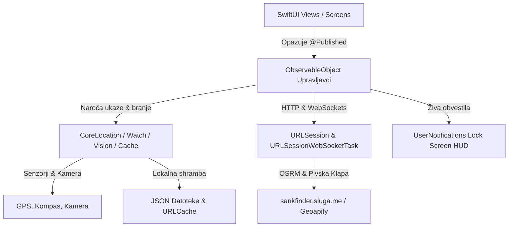

# 🍎 ŠankFinder iOS - Celovita Programerska Dokumentacija & Arhitektura

> **Različica aplikacije:** 1.2.0 (Build 37)  
> **Glavni jezik:** Swift 5.9+  
> **UI ogrodje:** SwiftUI + UIKit (MapKit integracija prek `UIViewRepresentable`)  
> **Ciljna platforma:** iOS 16.0+, watchOS 9.0+  
> **Zadnja posodobitev:** Oktober 2026

---

## 📌 Kazalo vsebine
1. [Pregled Projekta & Tehnološki Sklad iOS](#1-pregled-projekta--tehnološki-sklad-ios)
2. [Arhitektura Aplikacije (MVVM + Combine)](#2-arhitektura-aplikacije-mvvm--combine)
3. [Zemljevid Projekta & Struktura Datotek](#3-zemljevid-projekta--struktura-datotek)
4. [Navigacijski Sistem & Spodnja Vrstica (5 zavihkov)](#4-navigacijski-sistem--spodnja-vrstica-5-zavihkov)
5. [Ključni Moduli & Tehnične Rešitve](#5-ključni-moduli--tehnične-rešitve)
   - [5.1 Zemljevid & OpenStreetMap Over-Zoom Podpora (CustomMapView.swift)](#51-zemljevid--openstreetmap-over-zoom-podpora-custommapviewswift)
   - [5.2 Lokacija, Filtriranje Natančnosti & Sinhronizirano Stanje (LocationManager.swift & NetworkManager.swift)](#52-lokacija-filtriranje-natančnosti--sinhronizirano-stanje-locationmanagerswift--networkmanagerswift)
   - [5.3 Živa Obvestila na Zaklenjenem Zaslonu (LiveNavigationManager.swift)](#53-živa-obvestila-na-zaklenjenem-zaslonu-livenavigationmanagerswift)
   - [5.4 Podpora za Apple Watch (WatchConnectivityManager.swift)](#54-podpora-za-apple-watch-watchconnectivitymanagerswift)
   - [5.5 Prepoznavanje Računov z Apple Vision OCR & QR (HistoryManager.swift)](#55-prepoznavanje-računov-z-apple-vision-ocr--qr-historymanagerswift)
   - [5.6 Orodja & Igre (ToolsView.swift)](#56-orodja--igre-toolsviewswift)
   - [5.7 Pivska Klapa & Tracker Meni (SquadManager.swift & SquadView.swift)](#57-pivska-klapa--tracker-meni-squadmanagerswift--squadviewswift)
   - [5.8 Nastavitve & Globalno Uravnavanje Tipkovnice](#58-nastavitve--globalno-uravnavanje-tipkovnice)
6. [Postopek Gradnje & Generiranje IPA Paketa (CI/CD)](#6-postopek-gradnje--generiranje-ipa-paketa-cicd)
7. [Primerjalna Matrika Funkcionalnosti (iOS vs Android)](#7-primerjalna-matrika-funkcionalnosti-ios-vs-android)
8. [Navodila za Razvijalce & Sinhronizacija z Androidom](#8-navodila-za-razvijalce--sinhronizacija-z-androidom)

---

## 1. Pregled Projekta & Tehnološki Sklad iOS

ŠankFinder za iOS je izvorna (native) mobilna aplikacija, razvita posebej za operacijski sistem iOS z najsodobnejšim SwiftUI skladom. Uporablja identično vizualno podobo, barvno shemo in podatkovno zaledje kot Android različica, s čimer ponuja 100 % usklajeno uporabniško izkušnjo ne glede na uporabljeno napravo.

### Ključne tehnologije:
- **UI Ogrodje:** SwiftUI z deklarativnim stanjem in UIKit premostitvijo (`UIViewRepresentable`) za napreden nadzor nad `MKMapView`.
- **Oblikovni sistem:** Temna pivska tema s prilagojenimi barvnimi toni:
  - `BeerGold` (`#F59E0B` / `Color.yellow.opacity(0.9)`)
  - `DrajvGreen` (`#43A047` / svetlo zelena za aktivne označevalce in gumbe)
  - `DarkGreen` (`#2E7D32` / poudarjeno stanje izbranega lokala z zlato piko `#FFD54F`)
  - `NavGreen` (`#0F9D58` / smaragdno zelena navigacijska linija z belim robom)
  - `DrajvRed` (`#EF4444` / opozorila in prekinitev)
  - `SurfaceDark` (`#121826` / globoka nočna podlaga s prosojnim steklenim efektom)
- **Kartografija:** [MapKit](https://developer.apple.com/documentation/mapkit) z lastnim `OSMTileOverlay` podsistemom:
  - Uporaba OpenStreetMap Mapnik ploščic (`https://tile.openstreetmap.org/`).
  - `canReplaceMapContent = true` za popoln izklop Apple Maps vektorske podlage.
  - Dinamični Over-Zoom (do nivoja `z = 22`) z digitalnim izrezovanjem in povečevanjem ploščic iz izvornega `z = 19`.
  - Izklop združevanja v grozde (`clusteringIdentifier = nil`) in prioriteta `.required` za prijatelje.
- **Peš usmerjanje (Routing):** OSRM strežnik (`https://sankfinder.sluga.me/`) z avtomatskim rezervnim ponudnikom (`https://routing.openstreetmap.de/routed-foot/`) ter računanjem preostanka poti vzdolž polilinije.
- **Lokacija & Senzorji:** [CoreLocation](https://developer.apple.com/documentation/corelocation) z `kCLLocationAccuracyBestForNavigation`, filtrom razdalje 3.0 m, podporo za ozadje (`allowsBackgroundLocationUpdates`) ter natančnim kompasom (`CLHeading`).
- **Obvestila v živo:** [UserNotifications](https://developer.apple.com/documentation/usernotifications) s formatiranim HUD prikazom na zaklenjenem zaslonu ter potisnimi opozorili ob klicu runde.
- **Apple Watch integracija:** [WatchConnectivity](https://developer.apple.com/documentation/watchconnectivity) (`WCSession`) za dvosmerno sinhronizacijo poti in števca pijač.
- **Strojni vid & OCR:** [Apple Vision Framework](https://developer.apple.com/documentation/vision) (`VNRecognizeTextRequest`) ter `AVFoundation` v `HistoryView.swift` za hitro prepoznavo besedila računov in QR kod brez odvisnosti od oblačnih storitev.
- **Omrežje & WebSockets:** `URLSession` z diskovnim `URLCache` (256 MB) ter `URLSessionWebSocketTask` za realnočasovno klepetanje, števec rund in sledenje članom Pivske Klape.

---

## 2. Arhitektura Aplikacije (MVVM + Combine)

Arhitektura aplikacije sledi vzorcu **Model-View-ViewModel (MVVM)** z reaktivnimi tokovi podatkov prek ogrodja **Combine**:



- **Pogledi (`Views`):** Čisti SwiftUI pogledi, ki poslušajo stanje prek `@StateObject` ali `@ObservedObject`.
- **Upravljavci & Modeli stanja (`Managers`):**
  - `LocationManager`: Upravlja GPS, azimut, pravice lokacije in osredotočenje kamere.
  - `LiveNavigationManager`: Skrbi za posodabljanje obvestil na zaklenjenem zaslonu med navigacijo.
  - `WatchConnectivityManager`: Prenaša podatke na Apple Watch uro.
  - `SquadManager`: Skrbi za WebSocket povezavo, klepet in radarsko pozicijo prijateljev.
  - `HistoryManager`: Skrbi za lokalni dnevnik obiskov in OCR analizo računov.

---

## 3. Zemljevid Projekta & Struktura Datotek

```
c:/Android/SankFinder/iosApp/
├── SankFinder/
│   ├── SankFinderApp.swift              # Glavna vstopna točka (@main), zagon lokacije in obvestil
│   ├── MainTabView.swift                # 5-delni TabView, plavajoča značka za Klapo, globalna tema
│   ├── CustomMapView.swift              # MKMapView integracija, OSMTileOverlay z Over-Zoom, označevalci brez grozdenja, smerne puščice
│   ├── MapTabView.swift                 # Glavni zaslon zemljevida, kartica izbranega lokala, navigacijski HUD, kompas
│   ├── BarsListView.swift               # Seznam lokalov z iskanjem, filtri in hitro navigacijo
│   ├── ToolsView.swift                  # 5 orodij: Ruleta šankov, Burek pavza, Kolo sreče, Razdeli račun, Taksi klic
│   ├── HistoryView.swift                # Zgodovina obiskov, pregled računov in porabe, CameraReceiptScannerModalView (Vision OCR & QR)
│   ├── SettingsView.swift               # Nastavitve radija, števila lokalov in diagnostika sistema
│   ├── SquadView.swift                  # Vstop v Pivsko Klapo, koda sobe, klepet, runda števec in tracker meni
│   ├── SquadManager.swift               # Upravljavec WebSocket povezave, klepet in radarsko sledenje članom
│   ├── LocationManager.swift            # CoreLocation ovijalec (GPS kCLLocationAccuracyBestForNavigation, 3.0 m filter, azimut)
│   ├── LiveNavigationManager.swift      # Upravljavec zaklenjenega zaslona (Lock Screen HUD)
│   ├── GlobalSyncManager.swift          # Sinhronizacija v ozadju in globalno upravljanje dogodkov
│   ├── NetworkManager.swift             # REST in WebSocket mrežni klici z diagnostiko
│   ├── NavigationBridge.swift           # Dvosmerni most za prekinitev navigacije iz obvestil
│   ├── WatchConnectivityManager.swift   # WCSession most med iPhone in Apple Watch
│   ├── HistoryManager.swift             # Upravljanje lokalne shrambe obiskov (UserDefaults)
│   ├── Models.swift / Lokal.swift       # Lokal, Step, Route, SquadMember in podatkovni modeli
│   ├── MaterialComponents.swift        # Material 3 komponente in prilagojeni obrazci
│   ├── Theme.swift                      # Barvna tema, slogi in tipografija
│   ├── Info.plist                       # Sistemska dovoljenja (GPS, Always/InUse, Kamera, Background Modes)
│   └── Assets.xcassets/
│       ├── AppIcon.appiconset/          # Minimalistična moderna ikona aplikacije (1024x1024)
│       └── AccentColor.colorset/        # Zlata sistemska poudarjena barva
├── SankFinderWatch/                     # Aplikacija za Apple Watch (watchOS)
│   ├── SankFinderWatchApp.swift         # Vstopna točka za uro
│   ├── WatchContentView.swift          # Zapestni prikaz navigacijskih puščic, razdalje in pijač
│   └── WatchSessionManager.swift        # Sprejemnik podatkov iz iPhone telefona
├── build_ipa.sh                         # Skripta za sestavo nepodpisanega .ipa paketa
└── download_ipa.ps1                     # PowerShell skripta za prenos zgrajenega paketa iz GitHub Actions
```

---

## 4. Navigacijski Sistem & Spodnja Vrstica (5 zavihkov)

Glavno navigacijsko strukturo določa [MainTabView.swift](file:///c:/Android/SankFinder/iosApp/SankFinder/MainTabView.swift) s spodnjo orodno vrstico `TabView`:

| Zavihek | Ikona (SF Symbols) | Naslov | Opis delovanja |
|---|---|---|---|
| 0 | `list.bullet` | **Šanki** | Seznam bližnjih lokalov, razvrščenih po razdalji z oceno, delovnim časom in iskalnikom. |
| 1 | `wrench.and.screwdriver` | **Orodja** | 5 uporabniških orodij: Ruleta šankov, Kolo za rundo, Burek pavza, Razdeli račun, Taksi pomočnik. |
| 2 | `map` (Poudarjena sredina) | **Zemljevid** | Glavni zemljevid z OpenStreetMap ploščicami, GPS sledenjem, kompasom in vodenjem. |
| 3 | `clock.arrow.circlepath` | **Zgodovina** | Pregled preteklih obiskov, statistika porabe ter Vision OCR skener računov z FURS QR kodo. |
| 4 | `gearshape` | **Nastavitve** | Izbira radija (1-5 km), limita lokalov (10-100), diagnostika senzorjev in sistemske informacije. |

### Plavajoči gumb Pivske Klape:
Na zaslonu z zemljevidom se levo zgoraj nahaja plavajoča značka Pivske Klape. Če je uporabnik včlanjen v klapo, značka prikazuje kodo sobe, število članov v živo ter skupno število popitih piv (`Klapa: KODA (št.) • X piv`). S klikom nanjo se takoj odpre okno klepeta in runda števca brez zapuščanja zemljevida.

---

## 5. Ključni Moduli & Tehnične Rešitve

### 5.1 Zemljevid, Usmerjanje & Označevalci (CustomMapView.swift & MapTabView.swift)

Ker Apple MapKit privzeto izrisuje lastno podlago, je bilo potrebno izdelati napreden `MKTileOverlay` mehanizem, ki v celoti nadomesti Apple Maps:

```swift
class OSMTileOverlay: MKTileOverlay {
    private let maxNativeZ: Int = 19
    
    init() {
        super.init(urlTemplate: "https://tile.openstreetmap.org/{z}/{x}/{y}.png")
        self.canReplaceMapContent = true // 1. Popoln izklop Apple Maps
        self.maximumZ = 22               // 2. Dovoljen zum do z = 22
        self.tileSize = CGSize(width: 256, height: 256)
    }
}
```

#### Rešeni izzivi & Tehnične rešitve:
1. **Odprava utripanja med zumiranjem:**  
   Z nastavitvijo `self.canReplaceMapContent = true` MapKit popolnoma ustavi izrisovanje Apple Maps vektorske podlage v ozadju. Med nalaganjem novih ploščic ni več prosevanja Apple barv ali stavb.
2. **Digitalni Over-Zoom (Povečava nad z = 19):**  
   Uradni OpenStreetMap strežnik ponuja izvorne ploščice le do nivoja `z = 19`. Ko se uporabnik na iOS približa na manj kot 100 metrov (npr. `minCenterCoordinateDistance: 85.0`), naš algoritem v `loadTile(at:result:)`:
   - Izreže ustrezen kvadrant iz ploščice `z = 19` in ga z `UIGraphicsImageRenderer` poveča nazaj na polno ločljivost `256x256` točk.
   - Rezultat shrani v pomnilniški predpomnilnik (`tileCache`).
3. **Diskovni predpomnilnik (URLCache):**  
   Konfiguriran je namenski `URLSession` z diskovno kapaciteto **256 MB** in pomnilniško kapaciteto **64 MB**. Vsak zahtevek preveri kodo `HTTP 200` in veljavnost slikovnih podatkov (`UIImage(data:) != nil`).
4. **Razporeditev slojev (Overlay Levels):**  
   - `OSMTileOverlay` se doda na nivo `mapView.addOverlay(osmOverlay, level: .aboveRoads)`.
   - Navigacijska trasa `MKPolyline` se doda na nivo `uiView.addOverlay(polyline, level: .aboveLabels)`.  
   S tem je zagotovljeno, da je smaragdno zelena navigacijska linija (`#0F9D58` z belim robom 11pt/7pt) vedno na vrhu nad ploščicami.
5. **Ukrivljena puščica naslednjega manevra na cestišču:**  
   Razred `CurvedManeuverAnnotation` na točki naslednjega ovinka izriše dinamično ukrivljeno puščico, ki se samodejno poravna s smerjo cestišča in rotacijo zemljevida.
6. **Preprečevanje združevanja točk v grozde (Brez skrivanja prijateljev ob zoom outu):**  
   - `SquadFriendAnnotationView` (zlati označevalec prijatelja) ima `clusteringIdentifier = nil` in `displayPriority = .required`. S tem se prijatelji **nikoli ne skrijejo ali združijo**, tudi ko uporabnik močno pomanjša zemljevid.
   - Označevalec prikazuje: 32pt zlati krog z začetnico, zgoraj desno črno značko s številom pijač (`drinksBadge`) ter spodaj ime prijatelja (`nameLabel`).
   - Tudi lokali (`PubDotAnnotationView`) imajo `clusteringIdentifier = nil` in uporabljajo barvo `#43A047` z belo obrobo (ob izbiri preklopijo na `#2E7D32` z zlato piko `#FFD54F`).
7. **Dinamično sledenje korakom navigacije (< 18 m) & Razdalja po cesti:**  
   - Ko se uporabnik med peš navigacijo približa naslednjemu manevru na manj kot **18 metrov**, aplikacija v `MapTabView.swift` samodejno preskoči na naslednji korak (`currentStepIndex += 1`).
   - Preostala razdalja se ne računa kot zračna razdalja, temveč z namensko funkcijo `calculateRemainingRouteDistance` vzdolž **dejanskih koordinat OSRM polilinije**.
8. **Avtomatska rotacija in zvezno sledenje kamere v SMER HOJE (Route Course-Up slog):**  
   - **Zaklepanje na smer hoje (brez nihanja kompasa):** Usmerjenost kamere in zemljevida med aktivno navigacijo je strogo vezana na **vektor OSRM poti/ulice** (`calculateRouteWalkingBearing`), ki gleda 12–18 m naprej vzdolž trase. Nihanje telefona v roki in premiki kompasa med hojo tako ne vplivajo več na kamero, ki ostaja povsem mirna vzdolž ulice.
   - Ob zagonu navigacije se `MKMapCamera` avtomatsko nastavi na uporabnikovo lokacijo s peš razdaljo (`fromDistance = 320.0 m`) ter zasuče v smer začetnega odseka poti.
   - Med hojo kamera zvezno sledi uporabniku v središču zaslona (`isFollowingUser = true`), modra pika s puščico pa stabilno kaže naravnost naprej v smeri hoje. Kamera se zasuče le, ko uporabnik dejansko zavije na novo cesto.
   - Če uporabnik med navigacijo ročno podrsne po zemljevidu (`UIPanGestureRecognizer`), se samodejno sledenje začasno ustavi in prikaže se plavajoči gumb **"Centriraj"**. S klikom nanj se kamera takoj znova zaklene na uporabnika in zasuče v smer hoje vzdolž trase.
   - Ob prekinitvi navigacije ("Končaj" ali "X") se kamera zvezno poravna nazaj na sever (`heading = 0.0`) ter povrne običajen pregled.
9. **Plavajoči kompas za poravnavo proti severu:**  
   - Ko se zemljevid zasuče (`abs(mapHeading) > 5.0°`), se v zgornjem desnem delu prikaže plavajoči kompas.
   - Igla kompasa se v realnem času natančno vrti proti severu. Ob dotiku se kamera zemljevida z gladko animacijo poravna na sever (`heading = 0.0`).
10. **Centralna sinhronizacija radija in limita (Nastavitve):**  
   - Radij iskanja (`1 km`, `2 km`, `3 km`, `5 km`) in limit lokalov sta centralno povezana prek `@AppStorage("defaultRadiusKm")` in `@AppStorage("lokalLimit")`.
   - Zgornji del zemljevida je razbremenjen podvojenih menijev, seznam ([BarsListView.swift](file:///c:/Android/SankFinder/iosApp/SankFinder/BarsListView.swift)) in zemljevid ([MapTabView.swift](file:///c:/Android/SankFinder/iosApp/SankFinder/MapTabView.swift)) pa se ob spremembi v Nastavitvah samodejno in reaktivno ponovno naložita.

---

### 5.2 Lokacija, Filtriranje Natančnosti & Sinhronizirano Stanje (LocationManager.swift & NetworkManager.swift)

- **Filtriranje grobih in zastarelih GPS meritev:**
  - `LocationManager` zavrne meritve z negativno natančnostjo (`horizontalAccuracy < 0`) ter zastarele meritve iz sistemskega predpomnilnika (`abs(timestamp.timeIntervalSinceNow) > 120 s`).
  - Nastavljen je `activityType = .fitness`, natančnost `kCLLocationAccuracyBestForNavigation` ter natančen filter premika: `distanceFilter = 2.0 m` in `headingFilter = 3.0°`.
  - Aplikacija beleži natančnost (`accuracy`). Ko naprava pridobi natančen satelitski GPS sprejem (`accuracy <= 65 m`), [MapTabView.swift](file:///c:/Android/SankFinder/iosApp/SankFinder/MapTabView.swift) samodejno preusmeri kamero na pravo točko in osveži lokale za novo lokacijo.
  - Dinamično zaznavanje premika: ko se uporabnik premakne za več kot **250 metrov**, se lokali samodejno ponovno naložijo za novo območje.
- **Enoten vir resnice (Single Source of Truth) v `NetworkManager.shared`:**
  - `NetworkManager.shared` upravlja enoten `@Published var bars: [Lokal] = []`, kar zagotavlja, da sta zavihek **Zemljevid** in zavihek **Šanki** vedno 100 % usklajena brez podvojenih klicev API.
  - Vgrajen je seznam 15 zanesljivih lokalov v Ljubljani (Center, Krakovo, Šiška, Bežigrad), ki se samodejno prikažejo, če je omrežna povezava motena ali Geoapify API začasno nedostopen.
- **Kompas in ozadje:**
  - Vključuje popolno podporo za ozadje med navigacijo: `allowsBackgroundLocationUpdates = true` in `pausesLocationUpdatesAutomatically = false`.
  - Zaznava smer kompasa (`startUpdatingHeading()`), kar omogoča vrtenje usmerjevalnega stožca modre pike uporabnika (`UserHeadingAnnotationView`).

---

### 5.3 Živa Obvestila na Zaklenjenem Zaslonu & Center za Obvestila (LiveNavigationManager.swift)

Med aktivno peš navigacijo se v sistemskem centru za obvestila in na zaklenjenem zaslonu prikazuje dinamično obvestilo, oblikovano po zgledu sodobnih navigacijskih aplikacij (Google Maps / Apple Maps):

```
┌────────────────────────────────────────────────────────┐
│  ↰ 250 m • Zavijte levo na Slovensko cesto             │
│  Peš • 4 min (320 m) • Prihod ob 21:15                 │
│  ●━━━━━━━━━━━━━━━━━━━━○                                │
└────────────────────────────────────────────────────────┘
```

- **Prikaz brez prekrivanja ekrana:** V ospredju se obvestila dodajajo izključno v Center za obvestila (`.list`) in na zaklenjeni zaslon, medtem ko je pojavna pasica (`.banner`) izklopljena, tako da uporabniku med hojo nikoli ne zakrije zemljevida ali HUD vmesnika.
- **Posodabljanje v realnem času:** Ob vsakem premiku se osvežijo razdalja do ovinka, predviden čas hoje in ime naslednje ulice.
- **Prekinitev z enim dotikom:** Obvestilo vsebuje neposredno dejanje za zaustavitev navigacije brez odpiranja celotne aplikacije prek `NavigationBridge`.

---

### 5.4 Podpora za Apple Watch (WatchConnectivityManager.swift & SankFinderWatch)

- Implementira `WCSessionDelegate` za komunikacijo med iPhone-om in povezano uro Apple Watch (ekskluzivna iOS funkcija).
- **Zapestna navigacija:** Prenaša trenutno usmerjevalno puščico (npr. zavoj levo, naravnost, cilj), razdaljo v metrih in čas do naslednjega lokala.
- **Zapestni pivski števec:** Prikazuje trenutno število popitih pijač v Pivski Klapi in omogoča hitro dodajanje piva z zapestja (`+1`).

---

### 5.5 Prepoznavanje Računov z Apple Vision OCR & QR (HistoryView.swift & HistoryManager.swift)

Aplikacija vsebuje lokalni sistem računalniškega vida, ki ne potrebuje zunanjih plačljivih storitev:

1. **Prepoznava besedila in kamera skener (`CameraReceiptScannerModalView` v [HistoryView.swift](file:///c:/Android/SankFinder/iosApp/SankFinder/HistoryView.swift)):**
   - Uporablja `VNRecognizeTextRequest` z nastavitvijo `recognitionLevel = .accurate` in jezikovno podporo za slovenščino.
   - Hitro prepoznava vrstice z alkoholnimi pijačami (*Pivo, Laško, Union, Heineken, Cviček, Malvazija, Gin, Pelinkovec, Jack Daniels, Jägermeister, Vodka, Spritz, Aperol*).
   - Prepoznava brezalkoholne pijače (*Radenska, Donat, Naravna voda, Cedevita, Kava, Espresso, Cappuccino, Čaj, Coca Cola, Cockta, Fanta, Sprite, Ledeni čaj, Red Bull*).
   - Inteligentno izlušči količine (`1x`, `2x`, `0.5L`, `0.33L`) in končne zneske.
2. **Verifikacija FURS QR kode:**
   - Zazna QR kodo davčne blagajne, prebere zaščitno kodo izdajatelja računa (ZOI/EOR) in avtomatsko označi račun kot preverjen.
3. **Upravljanje shrambe ([HistoryManager.swift](file:///c:/Android/SankFinder/iosApp/SankFinder/HistoryManager.swift)):**
   - Shranjuje strukturirane obiske (`VisitRecord`) v `UserDefaults` z oceno lokala, zneskom in seznamom popitih artiklov.

---

### 5.6 Orodja & Igre (ToolsView.swift - 5 orodij)

- 🎲 **Ruleta Šankov (Naključni šank):**
  - Iz nabora naloženih barov naključno izbere destinacijo za večer.
  - Vsebuje hitri gumb za takojšen zagon peš vodenja.
- 🎡 **Kolo sreče ("Kdo plača rundo?"):**
  - Interaktivno vrteče se kolo s fizikalnim pojemanjem.
  - Smerna puščica je natančno nameščena na zgornjem robu kolesa brez zamikov.
  - Haptični odziv (`UIImpactFeedbackGenerator`) ob vsakem preskoku segmenta.
- 🥐 **Burek Pavza z delovnim časom v živo:**
  - Prikaz vseh priljubljenih pekarn (Pekarna Legiša Rimska, Dunajska, Burek Olimpija, Nobel itd.).
  - Samodejni izračun odprtosti (`🟢 Odprto zdaj` / `🔴 Zaprto`) glede na trenutno uro s filtrom za samo odprte točke.
  - Gumb za takojšen zagon peš navigacije.
- 💶 **Razdeli račun (Bill Splitter):** Enostaven vnos zneska, števila oseb in izbira napitnine.
- 🚕 **Taksi klic z naključnimi dialogi:** Zaporedje med 3 in 6 šaljivih prepričevalnih oken z direktno povezavo do klicnih številk lokalnih taksi služb (Taxi Metro, Taxi Laguna). Vrstni red in uvodni dialog sta vsakič znova naključno premešana iz nabora 10 različnih hudomušnih situacij, pri čemer so gumbi za klic in preklic navpično zloženi za kristalno jasno preglednost.

---

### 5.7 Pivska Klapa & Tracker Meni (SquadManager.swift & SquadView.swift)

- Skupinsko usklajevanje prek WebSocket protokola (`wss://sankfinder.sluga.me/ws` z varnim preklopom na lokalni naslov).
- **Varnostna sanitizacija napak:** Če strežnik ni dosegljiv, se v UI-ju **nikoli** ne izpišejo sistemske izjeme ali IP naslovi, temveč zgolj prijazno sporočilo o preverjanju povezave.
- **Poenotena statusna vrstica:** Zgornji del klepeta ima prečiščen, vitek dizajn z oznako sobe, številom članov, osebnim števcem (`+` / `-`) ter gumbom za odprtje trackerja.
- **Pivski Tracker Klape (Podmeni / Modalni list):**
  - Prikazuje skupno število popitih piv celotne mize.
  - Lestvica ("Top pivci") s poudarjenim vodilnim članom.
  - Seznam vseh prisotnih članov z njihovim točnim številom pijač.
  - Velik gumb **"Jaz častim naslednjo rundo!"**, ki sproži visoko-prioritetno obvestilo vsem članom klape.
- **Hitri gumbi za sporočila:** Hitro pošiljanje predpripravljenih stavkov (*Naročil sem rundo!*, *Kdo gre na hrano?*, *Pridem čez 5 min*, *Kje točno sedite?*).
- **Varnostno nagovarjanje / cmokanje ob zapuščanju klape:**
  - Klik na gumb za izhod iz sobe odpre serijo šaljivih dialogov, ki prijatelja prepričujejo, naj še ostane (*"A res že greš? Noč je še mlada!", "Lahko greš, ampak moraš dati za rundo!", "Kdor prvi odide, plača naslednjič dvakrat!"*, itd.).
  - Šele po potrditvi se povezava varno zaključi.
- **Izvoz klepeta (Spomini):** Izvoz celotne zgodovine klepeta s stanjem pijač prek sistemskega iOS deljenja (Share Sheet).

---

### 5.8 Nastavitve & Globalno Uravnavanje Tipkovnice

Za vrhunsko uporabniško izkušnjo so vsi vnosni obrazci opremljeni z:
- Orodno vrstico z gumbom **"Končano"** (`.doneButtonKeyboardToolbar()`) za enostaven umik številčne in besedilne tipkovnice.
- Interaktivnim umikom ob drsenju vsebine (`.scrollDismissesKeyboard(.interactively)`).
- Globalnim prepoznavalnikom dotika za zapiranje tipkovnice ob kliku na prazno površino.
- Sinhroniziranim radijem iskanja (1, 2, 3, 5 km) in limitom lokalov (10, 25, 50, po meri), ki reaktivno krmilita `NetworkManager.shared.loadBars()`.

---

### 5.9 Grafična Podoba, Logotip in Zagonski / Nalagalni Zaslon (Splash Screen)

- **Uradni logotip (PNG):** Prepoznavna ikona lokacijskega zatiča (map pin) z vrisanim pivskim kozarcem in belo peno na prosojni podlagi.
- **Ikone aplikacije (AppIcon.appiconset):**
  - Poln nabor resolucij za iOS (`1024x1024`, `180x180`, `120x120`, `87x87`, `80x80`, `58x58`, `40x40`) s temnim ozadjem `#0B1828` in natančno centrirano ikono.
- **Zagonski / Nalagalni zaslon (SplashScreenView.swift):**
  - Ob zagonu aplikacije se v [MainTabView.swift](file:///c:/Android/SankFinder/iosApp/SankFinder/MainTabView.swift) prikaže animiran zaslon ([SplashScreenView.swift](file:///c:/Android/SankFinder/iosApp/SankFinder/SplashScreenView.swift)) s prelivom `#0F172A` do `#060913`, utripanjem zatiča, pivskim sijem ter linearnim kazalnikom napredka.
  - V [BarsListView.swift](file:///c:/Android/SankFinder/iosApp/SankFinder/BarsListView.swift) se ob začetnem nalaganju lokalov prikaže logotip z zlatim indikatorjem.
- **Vgrajen nabor slik (Logo.imageset):**
  - Za uporabo v SwiftUI komponentah je na voljo vektorsko čist transparenten PNG zatič (`Image("Logo")`).

---

## 6. Postopek Gradnje & Generiranje IPA Paketa (CI/CD)

Projekt uporablja avtomatiziran GitHub Actions cevovod na macOS tekaču (`macos-latest`):

1. **GitHub Delotok:** `.github/workflows/ios-build.yml`
   - Preveri Swift sintakso in odvisnosti.
   - Zažene `xcodebuild` za prevajanje iOS cilja.
   - Ustvari arhiv `.xcarchive` in ga zapakira v nepodpisan `.ipa` paket.
   - Naloži artefakt `SankFinder.ipa` v GitHub Actions.
2. **Lokalni prenos paketa:**
   - Za prenos svežega `.ipa` paketa na delovno postajo se uporabi skripta:
     ```powershell
     powershell -ExecutionPolicy Bypass -File download_ipa.ps1
     ```
   - Ali Python orodje v scratch mapi:
     ```bash
     python download_artifact.py
     ```
   - **Opomba glede Azure Blob preusmeritve:** GitHub API ob prenosu artefakta vrne HTTP 302 preusmeritev na Microsoft Azure Blob Storage. Skripta uporablja `NoAuthRedirectHandler`, ki pri preusmeritvi odstrani glavo `Authorization`, saj Azure zavrne zahtevke s tujo GitHub avtentikacijo (HTTP 403 Forbidden).

---

## 7. Primerjalna Matrika Funkcionalnosti (iOS vs Android)

| Funkcionalnost / Modul | iOS (Swift / SwiftUI) | Android (Kotlin / Compose) | Stanje Paritete |
|---|---|---|:---:|
| **Zemljevid & OpenStreetMap ploščice** | MapKit + `OSMTileOverlay` (z = 1 do 22 Over-Zoom) | OSMDroid z diskovnim predpomnilnikom | 100 % Usklajeno |
| **Peš navigacija (OSRM)** | Primarni (`sankfinder.sluga.me`) + Fallback | Primarni (`sankfinder.sluga.me`) + Fallback | 100 % Usklajeno |
| **Natančno sledenje manevrov (< 18 m)** | Samodejni preskok koraka | Samodejni preskok koraka | 100 % Usklajeno |
| **Plavajoči kompas ob rotaciji** | Samodejni prikaz, klik poravna na sever | Samodejni prikaz, klik poravna na sever | 100 % Usklajeno |
| **Živa obvestila na zaklenjenem zaslonu** | UserNotifications Lock Screen HUD z dekrementom | Foreground HUD Notification s časom in korakom | 100 % Usklajeno |
| **Podpora za pametno uro** | Popolna samostojna aplikacija (Apple Watch `WCSession`) | Sistemska obvestila (Wear OS) | iOS razširjeno |
| **Skener računov (OCR & FURS QR)** | Apple Vision Framework (`VNRecognizeTextRequest`) | Google ML Kit (TextRecognition + Barcode) | 100 % Usklajeno |
| **5 Šank Orodij (Ruleta, Burek, Kolo, Račun, Taxi)** | Vseh 5 orodij z live burek statusom in naključnim taxijem | Vseh 5 orodij z live burek statusom in šaljivim taxijem | 100 % Usklajeno |
| **Pivska Klapa (Chat & WebSockets)** | Dvojna povezava (DNS + IP fallback), sanitizirane napake | Dvojna povezava (DNS + IP fallback), sanitizirane napake | 100 % Usklajeno |
| **Pivski Tracker & Runda klic** | Sheet meni, Toast + Sistemsko opozorilo ob rundi | BottomSheet meni, Heads-up obvestilo ob rundi | 100 % Usklajeno |
| **Nagovarjanje ob izhodu iz klape** | Večkratni šaljivi dialogi | Večkratni šaljivi dialogi | 100 % Usklajeno |
| **Radar prijateljev na zemljevidu** | Zlati označevalci brez grozdenja (`.required`) | Zlati označevalci z imenom in števcem pijač | 100 % Usklajeno |
| **Zanesljiva offline baza (Fallback)** | 15 lokalov (Center, Krakovo, Šiška, Bežigrad) | 15 lokalov (Center, Krakovo, Šiška, Bežigrad) | 100 % Usklajeno |
| **Filtriranje GPS natančnosti** | Zavrnitev `accuracy < 0`, preklop ob `accuracy <= 65m` | Zavrnitev grobih meritev, glajenje koordinat | 100 % Usklajeno |

---

## 8. Navodila za Razvijalce & Sinhronizacija z Androidom

Pri dodajanju novih funkcionalnosti se držite naslednjih načel:
- **Enotnost podatkovnih modelov:** Polja v `Models.swift` morajo ostati skladna z ustreznimi Kotlin podatkovnimi razredi v Android projektu.
- **OpenStreetMap pravilnik:** Pri klicih ploščic ohranite veljaven `User-Agent` (`SankFinderApp-Slovenia/1.2 (...)`), da se prepreči blokada s strani OSM strežnikov.
- **Preizkušanje zemljevida:** Ob vsaki spremembi `CustomMapView.swift` preverite nivoje zumiranja od `z = 1` do `z = 22` ter delovanje zavojev in obvestil na zaklenjenem zaslonu.

---
*Dokumentacijo vzdržuje ŠankFinder iOS razvojna ekipa. Za tehnična vprašanja odprite zahtevek v repozitoriju.*
