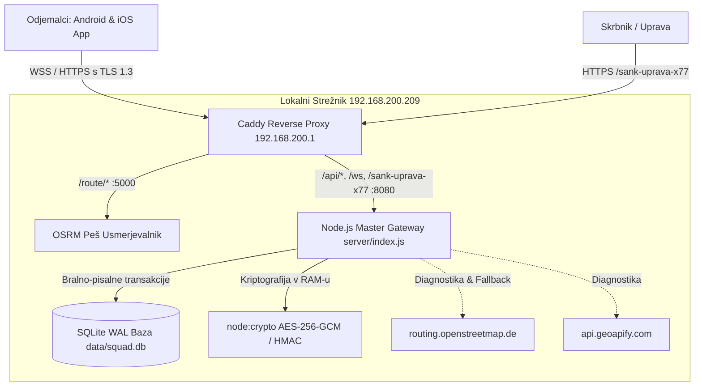

# 🍻 ŠankFinder Server - Celovita Strežniška Dokumentacija & Arhitektura

> **Različica strežnika:** 1.2.0 (Master Gateway Build 38)  
> **Okolje:** Node.js 20 LTS (vgrajeni moduli `http`, `https`, `node:crypto`, `ws`, `better-sqlite3`)  
> **Baza podatkov:** SQLite 3 z WAL načinom (`Write-Ahead Logging`)  
> **Reverzni posrednik (Reverse Proxy):** Caddy v2 s prisiljenim TLS 1.3 in HSTS  
> **Peš usmerjevalnik:** OSRM (Open Source Routing Machine) na vratih 5000  
> **Zadnja posodobitev:** Oktober 2026  
> 📱 **Povezani odjemalci:** [DOKUMENTACIJA.md (Android)](file:///c:/Android/SankFinder/DOKUMENTACIJA.md) in [DOKUMENTACIJA_IOS.md (iOS)](file:///c:/Android/SankFinder/DOKUMENTACIJA_IOS.md)

---

## 📌 Kazalo vsebine
1. [Pregled Strežniške Arhitekture](#1-pregled-strežniške-arhitekture)
2. [Mrežna Arhitektura, Caddy & TLS 1.3](#2-mrežna-arhitektura-caddy--tls-13)
3. [Baza Podatkov (SQLite WAL Način) & Podatkovni Model](#3-baza-podatkov-sqlite-wal-način--podatkovni-model)
4. [Kriptografska Zaščita & Varnost Podatkov](#4-kriptografska-zaščita--varnost-podatkov)
5. [Skrita Skrbniška Nadzorna Plošča (/sank-uprava-x77)](#5-skrita-skrbniška-nadzorna-plošča-sank-uprava-x77)
   - [5.1 Glava & Avtomatska Sinhronizacija](#51-glava--avtomatska-sinhronizacija)
   - [5.2 Zavihek 1: Pregled Aplikacije & Leaflet Live Radar](#52-zavihek-1-pregled-aplikacije--leaflet-live-radar)
   - [5.3 Zavihek 2: Globalna Push Obvestila](#53-zavihek-2-globalna-push-obvestila)
   - [5.4 Zavihek 3: Aktivne Naprave v Živo & Telemetrija](#54-zavihek-3-aktivne-naprave-v-živo--telemetrija)
   - [5.5 Zavihek 4: Pivska Klapa (Sobe, Klepet & Števci Piva)](#55-zavihek-4-pivska-klapa-sobe-klepet--števci-piva)
   - [5.6 Zavihek 5: Konfiguracija, Šank Tedna & Diagnostika](#56-zavihek-5-konfiguracija-šank-tedna--diagnostika)
6. [Pregled Vseh REST API Poti](#6-pregled-vseh-rest-api-poti)
7. [WebSocket Protokol & Sporočila v Živo](#7-websocket-protokol--sporočila-v-živo)
8. [Zagon v Produkciji (Docker Compose & UFW Požarni Zid)](#8-zagon-v-produkciji-docker-compose--ufw-požarni-zid)
9. [Varnostno Kopiranje & Čiščenje Podatkov](#9-varnostno-kopiranje--čiščenje-podatkov)

---

## 1. Pregled Strežniške Arhitekture

Strežniški del sistema ŠankFinder deluje kot centralni komunikacijski in usmerjevalni vozel (Master Gateway) za mobilne aplikacije na platformah Android in iOS ter skrbniški nadzorni center.



### Ključne prednosti strežnika:
1. **0 ms zakasnitev kriptografije:** Vsa šifriranja (AES-256-GCM, HMAC-SHA256, scrypt) se izvajajo neposredno v pomnilniku (RAM) z uporabo vgrajenega modula `node:crypto` in strojnega pospeševanja procesorja (Intel/AMD AES-NI).
2. **Ničelne zunanje odvisnosti v runtime-u:** Strežnik poleg lahkega `ws` in `better-sqlite3` nima nobenih zunanjih ogrodij (brez težkih frameworkov kot sta Express ali Nest), kar omogoča odzivnost pod 1 ms in porabo pomnilnika RAM okoli 30–45 MB.
3. **Visoka sočasnost (High Concurrency):** WebSocket arhitektura podpira več sto sočasnih aktivnih povezav s takojšnjim razpošiljanjem sporočil (Broadcast) po sobah.

---

## 2. Mrežna Arhitektura, Caddy & TLS 1.3

Javni dostop do strežnika poteka prek povratnega posrednika **Caddy v2** na naslovu `192.168.200.1` z domeno `sankfinder.sluga.me`.

### Konfiguracija `Caddyfile` ([server/Caddyfile](file:///c:/Android/SankFinder/server/Caddyfile)):
```caddy
sankfinder.sluga.me {
    # Prisiljen najsodobnejši kriptografski protokol TLS 1.3
    tls {
        protocols tls1.3
    }

    # Stroge varnostne glave za preprečevanje napadov
    header {
        Strict-Transport-Security "max-age=63072000; includeSubDomains; preload"
        X-Content-Type-Options "nosniff"
        X-Frame-Options "DENY"
        Referrer-Policy "no-referrer"
        -Server
    }

    # 1. Peš usmerjanje (OSRM navigacija)
    handle /route/* {
        reverse_proxy 192.168.200.209:5000
    }

    # 2. REST API klici
    handle /api/* {
        reverse_proxy 192.168.200.209:8080
    }

    # 3. WebSockets v živo (Pivska Klapa & Telemetrija)
    handle /ws* {
        reverse_proxy 192.168.200.209:8080
    }

    # 4. Skrita skrbniška nadzorna plošča
    handle /sank-uprava-x77* {
        reverse_proxy 192.168.200.209:8080
    }
}
```

---

## 3. Baza Podatkov (SQLite WAL Način) & Podatkovni Model

Baza podatkov se nahaja v mapi `data/squad.db`. Inicializirana je z ukazom:
```sql
PRAGMA journal_mode = WAL;
PRAGMA synchronous = NORMAL;
```
WAL način (Write-Ahead Logging) omogoča hkratno nemoteno branje in pisanje brez zaklepanja tabele, kar zagotavlja visoko prepustnost pri sočasnem sporočanju članov klape.

### Struktura Tabel:
1. **`rooms` (Sobe Pivske Klape):**
   - `id TEXT PRIMARY KEY` – enolični identifikator (npr. `room_1729000000`).
   - `code TEXT UNIQUE NOT NULL` – 4-mestna koda sobe (npr. `7K2B`).
   - `name TEXT NOT NULL` – poimenovanje mize/klape.
   - `created_at DATETIME DEFAULT CURRENT_TIMESTAMP`.
2. **`members` (Člani Klape & Live Lokacije):**
   - `id TEXT PRIMARY KEY` – enolični ID uporabnika.
   - `room_code TEXT NOT NULL` – koda sobe, kateri član pripada.
   - `name TEXT NOT NULL` – vzdevek člana.
   - `lat REAL, lon REAL` – **kriptografsko šifrirane koordinate** (`AES-256-GCM`).
   - `drinks_count INTEGER DEFAULT 0` – osebni števec piva.
   - `last_seen DATETIME DEFAULT CURRENT_TIMESTAMP`.
3. **`messages` (Klepet):**
   - `id INTEGER PRIMARY KEY AUTOINCREMENT`.
   - `room_code TEXT NOT NULL`.
   - `sender_id TEXT NOT NULL`.
   - `sender_name TEXT NOT NULL`.
   - `msg_type TEXT DEFAULT 'text'` – `'text'`, `'round'` ali `'admin'`.
   - `content TEXT NOT NULL` – **kriptografsko šifrirana vsebina** (`AES-256-GCM`).
   - `created_at DATETIME DEFAULT CURRENT_TIMESTAMP`.
4. **`app_devices` (Telemetrija naprav celotne aplikacije):**
   - `device_id TEXT PRIMARY KEY` – enolični hash naprave.
   - `model TEXT` – model telefona (npr. `iPhone 15 Pro`, `Samsung Galaxy S24`).
   - `os_version TEXT` – verzija operacijskega sistema (npr. `iOS 17.5`, `Android 14`).
   - `app_version TEXT` – različica aplikacije (npr. `1.2.0`).
   - `current_screen TEXT` – trenutni zaslon v živo (npr. `Zemljevid & Šanki`, `Pivska Klapa`).
   - `ip TEXT` – IP naslov povezave.
   - `first_seen DATETIME`, `last_seen DATETIME`.
5. **`push_notifications` (Zgodovina poslanih obvestil):**
   - `id INTEGER PRIMARY KEY AUTOINCREMENT`.
   - `title TEXT NOT NULL`, `message TEXT NOT NULL`, `category TEXT`.
   - `target TEXT DEFAULT 'all'` – ciljna skupina (`'all'`, `'ios'`, `'android'`, `'room:CODE'`, `'device:ID'`).
   - `sent_count INTEGER DEFAULT 0`.
   - `created_at DATETIME DEFAULT CURRENT_TIMESTAMP`.
6. **`app_settings` (Konfiguracija sistema):**
   - `key TEXT PRIMARY KEY` – npr. `'motd'`, `'featured_pub'`.
   - `value TEXT NOT NULL`.
   - `updated_at DATETIME DEFAULT CURRENT_TIMESTAMP`.

---

## 4. Kriptografska Zaščita & Varnost Podatkov

Strežnik vsebuje najvišje varnostne standarde za zaščito zasebnosti:

1. **At-Rest Šifriranje v SQLite z AES-256-GCM:**
   - Vsak vpis lokacije (`lat`, `lon`) in sporočila se pred zapisom v bazo šifrira s 32-bajtnim ključem `SERVER_MASTER_KEY` (iz `.env`).
   - Format zapisa: `enc:v1:<12B_IV_HEX>:<16B_AuthTag_HEX>:<Cipher_HEX>`.
   - V primeru odtujitve baze `squad.db` napadalec ne more prebrati nobenih koordinat gibanja ali besedil uporabnikov.
2. **Kriptografska Avtentikacija Skrbnika:**
   - Geslo se preverja prek zgoščka v spremenljivki `ADMIN_PASSWORD_HASH` z uporabo funkcije `crypto.scryptSync`.
   - Primerjava gesel poteka izključno s funkcijo `crypto.timingSafeEqual`, ki popolnoma preprečuje časovne napade (Side-channel Timing Attacks).
3. **In-Memory Rate Limiter (Omejevanje Poskusov Prijave):**
   - Največ 5 neuspešnih poskusov prijave na posamezen IP v 15 minutah. Po prekoračitvi se dostop nemudoma blokira z odzivom `HTTP 429 Too Many Requests`.
4. **Zaščiten Sejni Piškotek (`sank_admin_session`):**
   - Piškotek je opremljen z zastavicami `HttpOnly; Secure; SameSite=Strict; Max-Age=28800` (8 ur veljavnosti) in je kriptografsko podpisan z HMAC-SHA256, kar preprečuje XSS in CSRF napade.
5. **HMAC-SHA256 Podpisovanje API in WebSocket Zahtevkov:**
   - Zahtevki vsebujejo glavi `X-Sank-Signature` in `X-Sank-Timestamp` (ali parametra `sig` in `t` pri WebSockets).
   - Časovni žig se preveri glede na sistemski čas strežnika (odstopanje največ ±5 minut), kar preprečuje Replay napade.
6. **Samodejno Čiščenje Podatkov (Data Minimization):**
   - Urni cron posel (`setInterval` na vsakih 60 minut) iz baze trajno izbriše vse sobe, sporočila in lokacije, starejše od 24 ur.

---

## 5. Skrita Skrbniška Nadzorna Plošča (`/sank-uprava-x77`)

Skrbniški vmesnik je napreden, popolnoma odziven nadzorni center (Command Center), oblikovan po načelih sodobnega temnega steklenega videza (Glassmorphism):

### 5.1 Glava & Avtomatska Sinhronizacija
- **Uradni logotip:** Prikaz ikone `/logo.png` z zlatim sijem (`drop-shadow`).
- **Indikator delovanja:** Prikaz stanja v živo (`● Strežnik Aktiven`).
- **Čas delovanja (Uptime):** Dinamičen prikaz časa neprekinjenega teka (`Uptime: Xd Xh Xm`).
- **Odštevalnik osveževanja:** Odšteva od 5 do 0 sekund ter nato v ozadju reaktivno osveži vse podatke prek `/api/admin/data`.
- **Gumb Odjava:** Počisti sejni piškotek in varno zaključi skrbniško sejo (`/sank-uprava-x77/logout`).

### 5.2 Zavihek 1: Pregled Aplikacije & Leaflet Live Radar
1. **6 Obogatenih KPI Kartic:**
   - **Aktivne Naprave v Živo:** Skupno število povezanih naprav z ločenima značkama za platformi: `🍎 iOS: X` in `🤖 Android: Y`.
   - **Vse Registrirane Naprave:** Skupno število naprav v bazi ter novih v zadnjih 24 urah (`+X danes`).
   - **Poslana Push Obvestila:** Število vseh oddanih obvestil in točen čas zadnjega obvestila.
   - **Aktivne Pivske Klape:** Število trenutno aktivnih sob in število članov v njih.
   - **Skupaj Štetih Pijač:** Skupno število popitih piv ter izpostavljen vodilni pivec večera (`Top: [Ime] ([X] piv)`).
   - **OSRM Usmerjevalnik:** Odzivni čas v milisekundah z barvnim indikatorjem (`< 100 ms` zelena, `100–300 ms` zlata, `> 300 ms` rdeča) ter **mini zgodovinskim stolpičnim grafom** (zadnjih 10 meritev).
2. **Sredinski Leaflet.js Live Radar Zemljevid:**
   - Temne OpenStreetMap ploščice (CartoDB Dark Matter) brez zunanjih plačljivih licenc.
   - V živo izrisuje zlate utripajoče označevalce članov aktivnih Pivskih Klap z njihovo začetnico in števcem piva (`🍺 X`).
   - Klik na prijatelja prikaže podrobnosti: ime, koda sobe, pijače, točne koordinate in čas zadnje lokacije.
   - Izriše zeleno-zlati označevalec trenutnega **Šanka Tedna** (če je nastavljen).
   - Gumba *Centriraj na Ljubljano* in *Prilagodi pogled na vse*.
3. **Hitro Push Obvestilo s Predogledom na Zaklenjenem Zaslonu:**
   - Izbirnik ciljne skupine: `Vsi uporabniki`, `Samo iOS`, `Samo Android` ali `Določena Pivska Klapa`.
   - Hitre predloge z enim klikom (*Petkov Happy Hour*, *Burek Pavza*, *Posodobitev*, *Poziv Uprave*).
   - **Real-time Lock Screen Preview:** Realističen predogled pametnega telefona, ki med tipkanjem sproti prikazuje obliko obvestila z logotipom, uro in besedilom.
4. **Stanje Sistemskih Storitev & Telemetrija Strežnika:**
   - `Caddy Reverse Proxy (sankfinder.sluga.me)`: Port 80/443 (TLS 1.3 + HSTS).
   - `OSRM Slovenija Usmerjevalnik`: Port 5000 (odzivnost v ms).
   - `OSRM Fallback (openstreetmap.de)`: Zunanji OSRM ponudnik v primeru izpada.
   - `ŠankFinder Master Gateway`: Port 8080 (poraba pomnilnika RAM procesa v MB in število odprtih WebSocket povezav).
   - `SQLite Baza (WAL)`: Prikaz dejanske velikosti datotek `squad.db` in WAL na disku.
   - Gumba za vzdrževanje: `🧹 Počisti neaktivne sobe (> 24h)` in `💾 Prenesi varnostno kopijo (.db)`.

### 5.3 Zavihek 2: Globalna Push Obvestila
- Pregledna tabela vseh poslanih potisnih obvestil z ID-jem, naslovom, vsebino, ciljno skupino, številom prejemnikov in časom.
- Gumb `🔁 Ponovno uporabi`: samodejno napolni obrazec z besedilom izbranega obvestila.
- Gumb `🗑️ Izbriši`: odstrani zapis iz zgodovine.

### 5.4 Zavihek 3: Aktivne Naprave v Živo & Telemetrija
- Preklop med *Samo Online* in *Vse registrirane naprave* ter iskalnik po modelu, IP-ju in operacijskem sistemu.
- Tabela prikazuje:
  - Ikono platforme (`🍎` iOS / `🤖` Android), model naprave in verzijo OS.
  - Enolični identifikator naprave (`deviceId`) in verzijo aplikacije (`1.2.0`).
  - **Trenutni zaslon v živo (`screen`):** Barvna oznaka zaslona, na katerem se uporabnik trenutno nahaja (`Zemljevid & Šanki`, `Pivska Klapa`, `Zgodovina obiskov`, `Orodja`, `Nastavitve`).
  - Status v živo (utripajoča zelena pika za povezane) ali čas zadnje aktivnosti.
  - IP naslov povezave.
  - Gumb `🔔 Osebni Push`: odpre hitri vnos za pošiljanje obvestila neposredno samo tej napravi.

### 5.5 Zavihek 4: Pivska Klapa (Sobe, Klepet & Števci Piva)
- Seznam vseh sob v obliki kartic s kodo, številom članov, skupnimi pijačami in časom nastanka.
- Klik na **Klepet & Člani** odpre 2-delni modalni pregled v živo:
  - **Levi del (Klepet):** Prikaz pogovora v živo z gumbom za administratorski izbris posameznega sporočila (`🗑️`).
  - **Vnosno polje:** Skrbnik lahko pošlje uradno sporočilo, ki se na telefonih članov prikaže z zlato značko `👑 ŠankFinder Uprava`.
  - **Desni del (Člani):** Seznam članov z njihovimi zadnjimi koordinatami in gumboma `+` in `-` za takojšen **administratorski popravek števca pijač**, ki se v milisekundi sinhronizira z vsemi telefoni v sobi!
  - **Gumb za zaprtje sobe:** Skrbnik lahko celotno sobo z vsemi člani in sporočili trajno izbriše.

### 5.6 Zavihek 5: Konfiguracija, Šank Tedna & Diagnostika
- **Sporočilo dneva (MOTD):** Vnos globalnega sporočila, ki se ob vstopu takoj pošlje vsem povezanim napravam.
- **Šank Tedna (Featured Bar):** Določitev lokala (ime, naslov, koordinate in posebna ugodnost), ki se na zemljevidu izriše z zeleno-zlato zvezdico.
- **Sistemska Diagnostika API-jev:** Gumb `⚡ Hitri Test API-jev` iz strežnika izmeri odzivni čas primarnega OSRM-ja, rezervnega OSRM-ja in Geoapify Places API-ja ter izpiše rezultate v milisekundah.

---

## 6. Pregled Vseh REST API Poti

| Metoda | Pot | Opis | Zaščita |
|---|---|---|---|
| `GET` | `/api/health` | Preverjanje zdravja strežnika | Brezplačna |
| `GET` | `/logo.png`, `/favicon.png` | Uradni logotip in ikone za brskalnik | Brezplačna |
| `POST` | `/api/rooms/create` | Ustvarjanje nove sobe Pivske Klape | HMAC-SHA256 podpis |
| `POST` | `/api/rooms/join` | Vstop v sobo prek kode | HMAC-SHA256 podpis |
| `GET` | `/sank-uprava-x77` | Skrita skrbniška nadzorna plošča | Basic Auth + Sejni piškotek + Rate limit |
| `GET` | `/sank-uprava-x77/logout` | Skrbniška odjava | Sejni piškotek |
| `GET` | `/api/admin/data` | Celovita telemetrija za nadzorno ploščo | Sejni piškotek / Basic Auth |
| `POST` | `/api/admin/push/send` | Pošiljanje potisnega obvestila | Sejni piškotek / Basic Auth |
| `POST` | `/api/admin/push/delete` | Izbris obvestila iz zgodovine | Sejni piškotek / Basic Auth |
| `POST` | `/api/admin/settings/update`| Posodobitev MOTD ali Šanka Tedna | Sejni piškotek / Basic Auth |
| `GET` | `/api/admin/osrm/ping` | Test povezave z lokalnim OSRM | Sejni piškotek / Basic Auth |
| `GET` | `/api/admin/diagnostics` | Test odzivnosti vseh treh API ponudnikov | Sejni piškotek / Basic Auth |
| `GET` | `/api/admin/room/messages` | Pridobivanje sporočil in članov sobe | Sejni piškotek / Basic Auth |
| `POST` | `/api/admin/message/send` | Pošiljanje sporočila kot `👑 Uprava` | Sejni piškotek / Basic Auth |
| `POST` | `/api/admin/message/delete` | Izbris posameznega sporočila | Sejni piškotek / Basic Auth |
| `POST` | `/api/admin/member/drinks` | Popravek števila pijač člana (+/-) | Sejni piškotek / Basic Auth |
| `POST` | `/api/admin/room/delete` | Zaprtje in trajen izbris sobe | Sejni piškotek / Basic Auth |
| `POST` | `/api/admin/db/clean` | Čiščenje neaktivnih sob (> 24h) | Sejni piškotek / Basic Auth |
| `GET` | `/api/admin/db/backup` | Prenos varnostne kopije SQLite baze | Sejni piškotek / Basic Auth |

---

## 7. WebSocket Protokol & Sporočila v Živo

WebSocket strežnik teče na poti `/ws` (prek Caddyja dostopen na `wss://sankfinder.sluga.me/ws`).

### 1. Povezava naprave (Telemetrija celotnega appa):
Takoj ob zagonu mobilna aplikacija pošlje sporočilo o stanju naprave:
```json
{
  "type": "app_connect",
  "deviceId": "c14b8a...",
  "model": "iPhone 15 Pro",
  "osVersion": "iOS 17.5",
  "appVersion": "1.2.0",
  "screen": "Zemljevid & Šanki"
}
```
Ob vsakem prehodu med zavihki aplikacija pošlje:
```json
{
  "type": "screen_change",
  "screen": "Pivska Klapa"
}
```

### 2. Pivska Klapa Dogodki:
- **`join_room`:** Vstop uporabnika v sobo (posreduje `roomCode`, `userId`, `name`).
- **`chat_message`:** Pošiljanje besedila ali klica runde (`msgType: 'text'` ali `'round'`).
- **`location_update`:** Samodejno periodično pošiljanje GPS koordinat (`lat`, `lon`), ki se v bazi takoj šifrirajo z `AES-256-GCM`.
- **`drinks_update`:** Posodobitev števila pijač člana klape.
- **`leave_room`:** Varen izhod iz sobe po potrditvenem dialogu.

### 3. Povratna Sporočila Strežnika Odjemalcem:
- **`new_message`:** Novo sporočilo v klepetu.
- **`message_deleted`:** Obvestilo odjemalcem, naj sporočilo z ID-jem takoj odstranijo z zaslona.
- **`drinks_updated`:** Sinhroniziran števec piva za določenega uporabnika.
- **`member_locations`:** Posodobljene koordinate vseh članov sobe za izris na zemljevidu.
- **`global_push`:** Visoko-prioritetno potisno obvestilo, poslano iz nadzorne plošče.
- **`motd`:** Sporočilo dneva ob vstopu v aplikacijo.

---

## 8. Zagon v Produkciji (Docker Compose & UFW Požarni Zid)

Strežnik se poganja z Docker Compose v vsebniku `sankfinder-squad`.

### Zagon strežnika:
```bash
cd server
docker compose up -d --build
```

### Priporočena konfiguracija požarnega zidu (UFW) na `192.168.200.209`:
Da preprečite neposreden zunanji dostop mimo Caddyja:
```bash
sudo ufw default deny incoming
sudo ufw default allow outgoing
sudo ufw allow 22/tcp
# Dovoli dostop do OSRM (5000) in Gatewaya (8080) izključno iz naslova Caddy posrednika:
sudo ufw allow from 192.168.200.1 to any port 5000 proto tcp
sudo ufw allow from 192.168.200.1 to any port 8080 proto tcp
sudo ufw enable
```

---

## 9. Varnostno Kopiranje & Čiščenje Podatkov

1. **Prenos varnostne kopije z enim klikom:**
   - V nadzorni plošči (`/sank-uprava-x77`) kliknite gumb **💾 Prenesi varnostno kopijo (.db)** ali obiščite `/api/admin/db/backup`.
   - Strežnik pripravi konsistenten posnetek datoteke `data/squad.db`.
2. **Ročno čiščenje starih sob:**
   - Klik na gumb **🧹 Počisti neaktivne sobe (> 24h)** v nadzorni plošči nemudoma odstrani vse zapise neaktivnih sob in izvede `PRAGMA wal_checkpoint(TRUNCATE)`.
3. **Avtomatsko čiščenje:**
   - Vgrajeni mehanizem v `server/index.js` samodejno vsakih 60 minut preveri starost podatkov in poskrbi za minimalno hrambo podatkov v skladu z načelom *Data Minimization*.

---
*Dokumentacijo vzdržuje ŠankFinder razvojna ekipa. Za vprašanja ali varnostna poročila kontaktirajte skrbnika sistema.*
